# ASAR System and Software Development Plan

**Planning baseline:** 10 October 2026  
**Version:** 1.0  
**Delivery horizon:** 12 October to 31 December 2026  
**Project owner:** ASAR team  
**Design status:** Proposed implementation baseline for technical review

ASAR will extend its existing four wheel robot with Raspberry Pi compute, ROS 2 and a camera. The year end objective is a supervised indoor demonstrator that can perform remote visual inspection, execute a camera assisted task, and show repeatable safe behaviour when a controller, sensor or communication link fails. Map based waypoint navigation is a conditional increment that requires a supported scanning LiDAR and calibrated odometry.

The development sequence is to repair the existing control and readiness boundaries, establish reproducible builds, integrate the Raspberry Pi through the ESP32, then add ROS, camera processing and mission validation. The Mega remains the final software authority for motor outputs. A physical motor power cutoff remains independent of all software.

This plan contains the system scope, requirements, developer setup, electrical interfaces, pin allocations, static architecture, dynamic behaviour, algorithms, testing strategy, delivery responsibilities and acceptance evidence. New interfaces and numerical acceptance limits are **proposed engineering targets**. They must be confirmed through the gates defined in this plan before a release is accepted.

## Document control

| Version | Date | Change | Review responsibility |
|---|---|---|---|
| 1.0 | 10 October 2026 | System and software plan for Raspberry Pi ROS and camera integration | System lead with hardware software and test leads |

## Contents

1. Project baseline and engineering findings
2. Product scope and year end release
3. System requirements and acceptance limits
4. System architecture and controller interactions
5. Hardware setup power and pin mapping
6. Developer tools and reproducible environments
7. Repository structure and development process
8. Communication contracts and ROS interfaces
9. Overall dynamic design and end to end data flow
10. Raspberry Pi static and dynamic software design
11. ESP32 static and dynamic software design
12. Mega static and dynamic software design
13. Algorithms and calibration
14. Camera and ROS integration procedure
15. Testing setup and verification strategy
16. Core user scenarios and idea validation
17. Safety faults security and recovery
18. ARCI responsibilities and team operation
19. Work packages schedule and release gates
20. Risks decisions and release checklist
21. Requirements traceability
22. Sources glossary and engineering records

## 1 Project baseline and engineering findings

### 1 1 Repository baselines

The executable baseline is the main branch of ASAR Project. ASAR Team Hub provides team coordination, an Apps Script dashboard and an existing implementation plan. Source code takes precedence over descriptive documents for implemented behaviour. Hardware dimensions, fitted part numbers and measured performance require a separate physical configuration record.

| Repository | Reviewed commit | Role |
|---|---|---|
| ASAR Project | `396a0dea57170dcb91a20d0517c3bb8d596895fa` | ESP32 and Mega firmware mobile application relay and test sketches |
| ASAR Team Hub | `06c45c9423a7beffee04c8b8df1a9e32b7a717d9` | Team dashboard spreadsheet workflow and earlier engineering plan |

The commits above were retrieved from the repository commit endpoints. The repository files examined are listed in Chapter 22. This document is a new planning baseline; the existing repository plan remains historical input until the team adopts this version. [P1 P2]

### 1 2 Implemented software baseline

| Area | Implementation visible in source | Engineering consequence |
|---|---|---|
| ESP32 | Arduino sketch WiFi station WebSocket server on port 81 UART2 bridge | Current mobile path is a custom app rather than Blynk |
| Mega | Four motor outputs through two L298N boards side speed control encoder odometry ultrasonic sensing MPU telemetry reactive autopilot | Keep low level actuation and sensing on this controller |
| Motion | Side based differential control plus `WSPD` command | Independent wheel commands do not establish validated Mecanum kinematics |
| Mobile application | React 19 TypeScript Vite Tailwind Capacitor 6 direct and relay connection logic | Preserve the current client during interface migration |
| Relay | Node Express WebSocket optional Mega USB connection and simulation mode | Remove automatic physical fallback from the integrated robot path |
| Team Hub | Google Apps Script React 18 HTML frontend Sheets data local CSV preview | Use for work and evidence tracking rather than real time robot control |
| ROS and camera | No ASAR ROS workspace or camera pipeline in the reviewed source tree | Treat these as new deliverables |
| Ranging experiment | `tst/lidar_tst` reads UART bytes on ESP GPIO16 and GPIO17 | This conflicts with the production Mega UART pins and proves no scanning LiDAR integration |

### 1 3 Findings that change the implementation order

The findings below are code observations or explicitly identified engineering inferences. They are a backlog, not a claim that a hardware failure has already occurred. [P3 P4 P5 P6]

| ID | Finding and source | Required change before integration |
|---|---|---|
| F01 | ESP can enter RUNNING and broadcast RDY after 15 seconds without Mega bytes | Delete assumed readiness require valid Mega identity capabilities and readiness response |
| F02 | ESP sets `appConnected` on connect but has no disconnect branch and sends PING every 2 seconds | Revoke ownership on disconnect stop motion and separate connectivity from a valid command lease |
| F03 | Mega refreshes `lastRxMs` before command validation and stops after 5000 ms | Invalid traffic and ordinary PING must not renew the motion deadline |
| F04 | `WSPD` writes each wheel then stores side averages which the 20 ms side ramp writes back | Engineering inference confirmed by the two code paths independent wheel state is needed before four wheel control |
| F05 | `WSPD` has no RUNNING check before its direct pin writes | All motor commands must pass readiness ownership and safety checks in one actuator service |
| F06 | `pulseIn` blocks for up to 7000 microseconds and diagnostics contain blocking operations | Bound normal loop execution move echo measurement to a state machine and forbid active diagnostics during motion |
| F07 | RPM is reported every 500 ms IMU reporting defaults to 220 ms and LOG has no versioned measurement contract | Add timestamped ticks and IMU data suitable for ROS estimation |
| F08 | Front encoder A is interrupt driven while B gives direction only two wheel encoders are configured | Calibrate the actual count convention retain differential motion until other feedback is installed |
| F09 | Relay automatically attempts COM11 and promotes another observer when the leader closes | Use explicit physical transport selection stop before handover and require an explicit new arm |
| F10 | README and some specs mention Blynk obsolete test paths or a 9600 baud description | Update the executable interface documentation to WebSocket and 115200 baud |
| F11 | WiFi secrets appear as literals in tracked firmware and setup examples | Rotate exposed secrets remove them from tracked content and add a secret scanning check |
| F12 | Hub simulates user selection and the backend has a fallback user identity | Apply server side authorization before team data or administrative actions are exposed |
| F13 | Mega STOP calls `stopDrive` which sets side targets to zero while normal ramping remains active | Use immediate actuator inhibit and explicit disarm for accepted STOP separate from ordinary deceleration |

### 1 4 Evidence classifications

Use **Implemented** for code present in the reviewed baseline, **Proposed** for this plan's new design, **Measured** for a recorded hardware result, and **Conditional** for work that depends on an unresolved purchase or hardware decision. Code presence alone does not demonstrate safe operation or acceptance. Each test record must identify the hardware revision and the software commits used.

## 2 Product scope and year end release

### 2 1 Intended users and operating environment

The initial users are an operator who drives or assigns a task, an observer who watches telemetry and video, a developer who calibrates or diagnoses the robot, and a test engineer who validates its behaviour. Operate on a flat indoor test floor inside a marked area with an accessible motor power cutoff. Agree the actual payload, floor material, lighting range and maximum slope at Gate G0.

The first use case hypothesis is that a user can inspect a small indoor area from a safe position using live video and robot telemetry. A second hypothesis is that an operator can request a simple camera assisted mission, such as identifying a labelled inspection station, without continuously steering. These hypotheses should be tested with representative users and measured task outcomes.

### 2 2 Release scope

| Scope class | Capability | Release treatment |
|---|---|---|
| Mandatory R1 | Safe startup stop command physical cutoff command ownership and timeout | Complete before free floor motion |
| Mandatory R1 | Reproducible firmware mobile relay and Hub setup | Clean workstation builds and configuration records |
| Mandatory R1 | Raspberry Pi 5 integration dedicated communication link health and logging | Full controller chain with no bypass path |
| Mandatory R1 | ROS 2 robot model calibrated wheel and IMU telemetry local odometry | Publish a coherent frame and measurement graph |
| Mandatory R1 | Live camera inspection stream camera calibration and camera loss detection | Validate remote inspection and tagged station observation |
| Mandatory R1 | Supervised camera assisted mission operator takeover and cancellation | Demonstrate useful task completion with traceable evidence |
| Conditional R2 | Scanning 2D LiDAR map creation saved map localization and Nav2 waypoints | Requires hardware availability driver support and G4 performance |
| Conditional R2 | Four wheel holonomic Mecanum motion | Requires confirmed wheel geometry four feedback channels and a redesigned Mega actuator path |
| Stretch | Quantized object detector person following voice commands or edge language model | Start only after mandatory acceptance passes |

The earlier Team Hub plan includes LiDAR SLAM and edge language models. Preserve those workstreams as conditional and stretch scope. The user's required Raspberry Pi ROS and camera additions remain the minimum year end release. A monocular camera and four ultrasonic sensors do not by themselves satisfy a reliable map based navigation requirement.

### 2 3 Boundaries and constraints

R1 does not claim unrestricted autonomous operation, safe interaction with people, medical or industrial certification, outdoor navigation, stair handling, self charging, or continuous internet control. These capabilities require separate requirements and physical evidence. The initial ROS motion model is differential with `vy = 0`; sideways commands must be rejected until the holonomic increment is accepted.

Use a maximum proposed commissioning speed of 0.25 m/s and angular rate of 0.6 rad/s. Raise either only through a measured braking and obstacle clearance review. The robot should remain within an operator supervised test area throughout this plan.

### 2 4 Hardware and procurement baseline

| Item | Quantity | Selection or confirmation criterion |
|---|---:|---|
| Raspberry Pi 5 with 8 GB RAM | 1 | Proposed compute baseline active cooling rigid mounting |
| Storage | 1 | 64 GB minimum practical starting point 128 GB preferred endurance appropriate for logs |
| Pi regulated supply | 1 | 5 V 5 A capable Pi compatible USB C supply path verify peripheral current negotiation |
| USB UVC camera | 1 | Verified Ubuntu ARM64 V4L2 support fixed mount configurable exposure |
| Camera Module 3 alternative | 1 | Conditional CSI software compatibility gate and appropriate Pi 5 camera cable |
| 3.3 V USB UART adapter | 1 | True 3.3 V TX level accessible TX RX GND unique serial identity |
| ESP32 and Mega | 1 each | Confirm exact board and module revisions from the existing build |
| Motor drivers motors encoders and sensors | Existing set | Record all part numbers current ratings gear ratios pulse counts and voltage levels |
| Level translation for Mega and ESP link | 1 interface | Push pull UART translation in both directions rated for 115200 baud |
| Fuses cutoff wiring regulator mounting | As designed | Rated from measured load stall current cable and connector capacity |
| Scanning 2D LiDAR | 1 conditional | ROS Jazzy compatible driver LaserScan output usable field of view and indoor range |
| Rear encoders or external counter | 2 conditional | Required before four wheel feedback control |

Obtain quotations after confirming local availability and the actual hardware BOM. Set the approved spending limit at G0. Battery chemistry capacity and the existing motor supply voltage are open design values; the 3S and 12.6 V figures in earlier conceptual material must not be treated as fitted hardware ratings.

## 3 System requirements and acceptance limits

### 3 1 Functional requirements

All requirements below are proposed release requirements. Acceptance targets apply to the release candidate, not to the current firmware.

| ID | Requirement | Acceptance evidence |
|---|---|---|
| SYS01 | The system shall remain disarmed after boot reset reconnect or firmware update | Ten starts and ten reconnects with zero unintended motor enable |
| SYS02 | Only one valid motion owner shall command at a time | Concurrent operator ROS and observer attempts respect the lease |
| SYS03 | Any connected client may request STOP and physical cutoff shall remove motor energy independently | STOP fault and cutoff tests pass |
| SYS04 | Expired malformed unauthorized or old session traffic shall not sustain motion | Invalid traffic after the last valid motion command causes timeout |
| SYS05 | The operator shall drive forward reverse and rotate while viewing telemetry | Verified direction speed signs and operator inspection route |
| SYS06 | The system shall measure ticks IMU and obstacle ranges with validity and timestamps | Calibration packet consistency and freshness report |
| SYS07 | Pi communication loss shall stop ROS commanded motion without waiting for ROS recovery | Actuation inhibited within the agreed timeout budget |
| SYS08 | The camera shall supply calibrated images and a visible live inspection feed | Camera calibration image continuity and latency tests |
| SYS09 | Camera dependent missions shall pause safely when frames become stale | Unplug freeze and delayed frame tests |
| SYS10 | The mission interface shall support request cancel status success and failure | Task action and UI tests including takeover |
| SYS11 | A labelled inspection station shall be detected and reported from the robot | Held out station detection scenario passes |
| SYS12 | A close obstacle or invalid required obstacle channel shall prevent unsafe motion | Direction relevant obstacle and no echo tests |
| SYS13 | ROS shall publish robot frames odometry diagnostics and replayable measurements | No competing TF publishers bag replay checks |
| SYS14 | Releases shall identify all ECU app configuration and calibration versions | Clean rebuild and compatibility rejection tests |
| SYS15 | Team Hub shall associate work completion with a review and evidence link | Task update permission and evidence workflow tests |
| SYS16 | Conditional navigation shall reach selected mapped waypoints and stop on localization loss | Map localization and repeated waypoint scenarios |
| SYS17 | Conditional holonomic drive shall command and observe each wheel independently | Four encoder calibration and translation rotation tests |

### 3 2 Proposed performance limits

| ID | Metric | Initial acceptance target | Measurement |
|---|---|---|---|
| NFR01 | Valid motion command rate | 20 Hz from active source latest value queue only | Capture source and ESP logs |
| NFR02 | Motion command age | Expire after 300 ms at Mega | Logic analyser correlated with last accepted command |
| NFR03 | Software stop execution | Motor enable zero within 50 ms of accepted STOP or detected expiry | PWM and enable traces |
| NFR04 | Loss to actuation inhibit | At most 350 ms after last valid motion sample | Combined age and actuation budget |
| NFR05 | ROS wheel and IMU output | Ticks 50 Hz IMU 50 Hz proposed while running | Bag topic frequency and interarrival distribution |
| NFR06 | Required sensor freshness | Front range under 200 ms IMU and ticks under 100 ms when used | Monotonic age monitor |
| NFR07 | Live inspection video | At least 15 FPS at 640 by 480 p95 displayed age at most 500 ms on test LAN | Timestamp overlay and synchronized capture |
| NFR08 | Fiducial perception | At least 10 processing FPS p95 result age at most 300 ms | Recorded dataset and CPU load test |
| NFR09 | System endurance | 30 minute mixed mission run without uncontrolled motion or unexpected restart | Power thermal timing and memory log |
| NFR10 | Headroom | At least 20 percent CPU capacity and 20 percent free RAM under nominal combined load | Pi process and system metrics |
| NFR11 | Observation completeness | At least 99 percent required telemetry samples in a nominal 10 minute run | Sequence gap counters |
| NFR12 | Local TF consistency | One owner per dynamic edge no future timestamps or pose jump hidden from mission | Frame audit and injected reset |

These limits are provisional. Reconcile camera processing, range scanning and serial bandwidth at G1 and G3. A target change must update the affected test, hazard analysis and architecture decision; it cannot be silently relaxed to make a demonstration pass.

### 3 3 Braking and sensing budget

Derive obstacle clearance from measured speed and deceleration rather than retaining a single PWM based threshold. Use `d_stop = v * T_total + v^2 / (2 * a_min) + margin`, where `T_total` includes measurement age processing communication and motor response. At 0.25 m/s, a 0.35 second reaction budget, measured deceleration of 0.5 m/s² and a 0.10 m margin imply 0.25 m of clearance. Those deceleration and margin values are design examples, not robot measurements.

Measure braking on the actual floor at battery high and low states with the final payload. Choose the front stop threshold above the worst measured requirement; 0.30 m is an initial commissioning value only. Apply different geometry and sensor requirements to reversing and turning. Do not enable automatic reverse when the rear channel is invalid.

## 4 System architecture and controller interactions

### 4 1 Overall static architecture

Figure 1 describes the proposed integrated robot. The command and measurement channels are separate from the camera stream and from Team Hub administration.

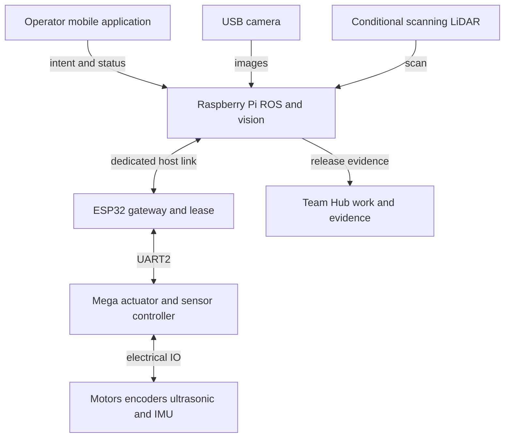

**Figure 1 Overall controller architecture.** Live robot control terminates in the Mega actuator service. Team Hub receives evidence and progress records through a developer workflow; it does not issue runtime motion commands.

### 4 2 Allocation of responsibilities

| Controller or component | Owns | Interface boundary |
|---|---|---|
| Raspberry Pi | ROS lifecycle camera perception mission orchestration odometry fusion optional mapping and navigation | Requests motion under a lease observes final accepted state |
| ESP32 | App and Pi connections identity and session control command lease bounded routing protocol adaptation | One selected motion owner all stop requests forwarded |
| Mega | Motor state speed control command expiry sensor acquisition immediate inhibit and fault latch | Reject commands that fail mode safety capability or age checks |
| Camera | Exposure and image acquisition through its driver | Never decides motor output |
| Optional LiDAR | Ranging and scan acquisition through its driver | Navigation geometry requires fresh scans |
| Mobile app | Operator intent deadman input mode confirmation video and status display | Sends mission intents to Pi or explicit stand alone manual control to ESP |
| Relay | Optional authenticated transport for observation or controlled remote session | Cannot bypass ESP lease or Mega safety logic |
| Team Hub | Tasks training reviews evidence links and release readiness | Independent of motion execution |

### 4 3 Connection modes

**Integrated mode** is the year end baseline. The app connects to the Pi mission API. The Pi talks to ESP through a dedicated wired host UART described in Chapter 5. The ESP continues to own UART2 to the Mega. ROS teleop and navigation share a Pi command selector and a single ESP lease.

**Standalone manual mode** preserves direct app to ESP WebSocket control for local development. It requires the same lease and timeout rules. Integrated ROS control must be explicitly released and all wheels stopped before entering this mode. A WiFi control fallback is not automatic.

**Observe mode** permits telemetry and video without a motion lease. An observer may request STOP. **Simulation mode** uses a mock transport with a conspicuous mode indicator and no connected physical actuator. Simulated telemetry must carry a source flag and cannot be mixed with hardware acceptance evidence.

The existing backend can route directly to Mega USB. In the target robot configuration this transport is disabled. Retain it only as an explicitly selected isolated bench transport with motors lifted and a distinct configuration file.

### 4 4 Safety authority and power topology

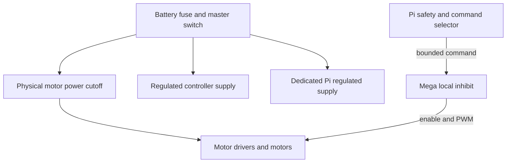

**Figure 2 Power and stop authority.** Separate regulated branches reduce shared supply disturbances; this drawing does not claim galvanic isolation. Measure grounding and noise behaviour. The cutoff switch or rated switching device must interrupt the motor energy branch even if Pi ESP and Mega software has failed.

## 5 Hardware setup power and pin mapping

### 5 1 Hardware configuration record

Before rewiring, photograph and label the chassis harness. Record the board revision battery label motor and gearbox part numbers driver board jumper states sensor module revisions wheel diameter track width encoder count convention and mounting poses. Perform continuity checks with power disconnected. Every wire needs a signal label at both ends and a connector number in the wiring record.

Inspect wheel type and roller orientation physically. The reviewed code supports a side based model and the previous plan refers to Mecanum imagery from another repository. That description is not a confirmed mechanical configuration for this baseline.

### 5 2 Confirmed Mega signal allocation

The following digital pin assignments match the reviewed Mega firmware and hardware specification. They identify intended signals in code; verify actual harness continuity before energizing. The direction column is relative to the Mega. [P4 P7 H1]

| Subsystem | Signal | Mega pin | Direction | Connection |
|---|---|---:|---|---|
| ESP UART2 | TX2 | D16 | Out | Level translator to ESP GPIO16 RX |
| ESP UART2 | RX2 | D17 | In | Level translator from ESP GPIO17 TX |
| Front ultrasonic | TRIG | D22 | Out | Front sensor trigger |
| Front ultrasonic | ECHO | D23 | In | Front sensor echo |
| Right ultrasonic | TRIG | D24 | Out | Right sensor trigger |
| Right ultrasonic | ECHO | D25 | In | Right sensor echo |
| Rear ultrasonic | TRIG | D26 | Out | Rear sensor trigger |
| Rear ultrasonic | ECHO | D27 | In | Rear sensor echo |
| Left ultrasonic | TRIG | D28 | Out | Left sensor trigger |
| Left ultrasonic | ECHO | D29 | In | Left sensor echo |
| Indicator | Buzzer | D30 | Out | Driver transistor if required by buzzer current |
| Indicator | Status LED | D31 | Out | Series resistor and LED |
| Left driver channel A | IN1 IN2 | D32 D33 | Out | Front left direction |
| Left driver channel B | IN3 IN4 | D34 D35 | Out | Rear left direction |
| Right driver channel A | IN1 IN2 | D36 D37 | Out | Front right direction |
| Right driver channel B | IN3 IN4 | D38 D39 | Out | Rear right direction |
| Left driver channel A | ENA | D5 PWM | Out | Front left enable PWM |
| Left driver channel B | ENB | D6 PWM | Out | Rear left enable PWM |
| Right driver channel A | ENA | D8 PWM | Out | Front right enable PWM |
| Right driver channel B | ENB | D9 PWM | Out | Rear right enable PWM |
| Front left encoder | A B | D18 D19 | In | Interrupt on A direction from B |
| Front right encoder | A B | D2 D3 | In | Interrupt on A direction from B |
| MPU6050 | SDA | D20 | In/Out | I2C SDA |
| MPU6050 | SCL | D21 | Out | I2C SCL address currently 0x68 |

Motor channel associations FL RL FR RR follow the `WSPD` handler. Remove L298N EN jumpers when external PWM is used, subject to the exact driver board schematic. Confirm each output with the isolated motor test; wheel labels and inversion flags must match the physical harness.

### 5 3 ESP32 Pi and host wiring

The production Mega link uses the existing ESP UART2. Add a separate proposed ESP UART1 host link on unused classic ESP32 GPIO25 and GPIO26. A Pi USB to 3.3 V UART adapter avoids reliance on Pi 5 header UART configuration and leaves the existing USB debug connection available. This new host parser does not exist in the reviewed firmware and is a WP03 deliverable. [P3 H2]

| Endpoint A | Endpoint B | Level or connector | Status |
|---|---|---|---|
| Mega D16 TX2 | ESP GPIO16 RX2 | Translate 5 V to 3.3 V | Existing pin allocation electrical translation must be verified |
| ESP GPIO17 TX2 | Mega D17 RX2 | Translate 3.3 V to 5 V or verify receiver margins under the exact MCU specification | Existing pin allocation |
| Pi USB host port | USB UART adapter | USB data adapter with unique serial ID | Proposed host transport |
| Adapter TXD | ESP GPIO25 UART1 RX | 3.3 V push pull | Proposed new host input |
| ESP GPIO26 UART1 TX | Adapter RXD | 3.3 V push pull | Proposed new host output |
| Adapter GND | ESP GND | Common signal reference | Required |
| Adapter VCC | No connection | Do not join independent supply outputs | Required wiring rule |
| ESP GND | Mega GND | Shared signal reference at planned ground point | Required |
| Pi USB port | UVC camera | USB data and rated peripheral power | Proposed camera baseline |
| Pi USB port | Scanning LiDAR interface | Selected device USB data and power budget | Conditional |

Use `Serial1.begin(115200, SERIAL_8N1, 25, 26)` as the proposed ESP host configuration. Do not move the Mega UART to these pins. GPIO16 and GPIO17 may have different availability on ESP variants with PSRAM; the selected DOIT board must be checked by module marking before applying this map.

The Pi 40 pin header is unused for primary control. For reference, physical pin 6 is GND, physical pin 8 is GPIO14 and physical pin 10 is GPIO15; these are **reserved alternative UART resources**, not connections required by this design. Physical pins 2 and 4 are 5 V and pin 1 is 3.3 V. No Mega 5 V signal may connect to Pi GPIO. A header UART alternative requires a separate OS overlay and pin review before use. [H3]

### 5 4 Proposed safety and extension pins

| Function | Proposed pin | Electrical and software condition |
|---|---|---|
| Cutoff auxiliary contact | Mega D40 | Normally closed contact to GND with pullup healthy LOW broken wire or open contact HIGH fault latch |
| Optional rear left encoder A B | Mega A8 A9 digital D62 D63 | Pin change interrupt implementation on port K or external counter required |
| Optional rear right encoder A B | Mega A10 A11 digital D64 D65 | Pin change interrupt implementation CPU load and signal integrity gate required |
| Additional sensor bus | No fixed allocation | Review current pin resource matrix before assignment |

D40 is for status observation only. It does not replace the physical cutoff circuit. Rear encoder assignments are reserved proposals; they are not `attachInterrupt` pins in the standard Mega API. Do not enable four wheel closed loop control until the ISR or external counter design has passed pulse rate tests.

### 5 5 Electrical integration procedure

1. Remove motor energy and disconnect the battery. Check connector polarity and fuse ratings.
2. Verify the exact motor voltage and stall current with a current limited bench setup. Select drivers and supply protection from measured loads rather than the L298N marketing headline.
3. Check regulator output with the Pi camera ESP and Mega attached, first at idle and then under the planned load. Use a scope for motor start and reversal transients.
4. Install UART level translation. The ESP is a 3.3 V device and the Mega board uses 5 V logic; the direct connection described in older material must not be assumed safe. [H1 H2]
5. Inspect the MPU module regulator and I2C pullups. Many breakout boards differ. Measure SDA and SCL high levels and use an appropriate translator or 3.3 V pullup arrangement confirmed against both receivers.
6. Keep motor current paths away from sensor returns. Route the UART pair with a ground reference and short secured wiring. Separate camera cable and IMU mounting from high current harness movement.
7. With wheels lifted, energize logic first, verify disarmed status, then motor power. Test the physical cutoff before sending motion.
8. Label the approved harness revision and capture continuity power thermal and cutoff evidence.

Pi 5 exposes 22 pin camera connectors, so Camera Module 3 requires the correct adapter cable. A Pi supply should support the intended 5 V 5 A path and peripheral budget; a supply detected as 3 A can restrict USB peripheral current. Confirm power negotiation on the final robot rather than only the regulator's label. [H3]

## 6 Developer tools and reproducible environments

### 6 1 Toolchain baseline

| Layer | Tool or technology | Baseline and use |
|---|---|---|
| Source control | Git and GitHub | Main protected feature branches reviewed pull requests immutable release tags |
| Editing | VS Code Arduino IDE 2 | VS Code for all code IDE for initial board bringup and serial inspection |
| Firmware builds | Arduino CLI 1.5.1 candidate | Current published CLI release checked on 10 October validate both sketches before freezing |
| Mega core | Arduino AVR core | Select and record exact working release do not assume an unrecorded workstation installation |
| ESP core | Espressif Arduino core 3.3.12 candidate | Published release checked candidate must pass firmware build and UART timing tests |
| ESP sockets | arduinoWebSockets 2.7.2 candidate | `WebSocketsServer.h` provider proposed initial pin |
| Pi OS and ROS | Ubuntu Server 24.04 ARM64 ROS 2 Jazzy | Proposed stable platform Jazzy support through May 2029 |
| ROS packages | rclcpp rclpy tf2 robot_state_publisher robot_localization rosbag2 | Runtime interfaces estimation and evidence |
| Conditional autonomy | slam_toolbox Nav2 | Scan based mapping localization planning and collision monitor |
| Simulator | Gazebo Harmonic and ros_gz | Proposed Jazzy paired simulator desktop runs before hardware |
| Computer vision | OpenCV ArUco ChArUco V4L2 camera driver | Initial camera assisted task and calibration |
| Web application | Existing React 19 Vite 6 TypeScript 5.8 Capacitor 6 | Preserve installed package baseline commit lockfiles |
| Node runtime | Node 24 LTS candidate | Verify serialport and Capacitor tooling use one recorded patch release |
| Web tests | Vitest React Testing Library Playwright | Add tests for control state telemetry and user scenarios |
| MCU tests | Native C++ tests plus pytest pyserial HIL harness | Parser algorithm and physical interface verification |
| Hub | Apps Script Sheets local CSV server optional clasp | Versioned dashboard workflow staging and permissions |
| Bench tools | DMM current limited PSU logic analyser oscilloscope | Electrical and timing evidence |

Exact patch versions from existing developer machines are not present in the reviewed repository. Candidate versions above are selection inputs, not a claim that the project has already built with them. At G1 write `toolchain.lock.json`, commit npm lockfiles for the app and backend, and save a ROS package manifest and OS image checksum. [S1 S2 S3 S4 S5]

### 6 2 Workstation setup

Use native Ubuntu 24.04 for ROS simulation and hardware tests, or Windows 11 with WSL2 Ubuntu 24.04 for development plus native Windows Arduino upload tools. Check USB pass through and ROS discovery explicitly when using WSL2. The Pi runs ARM64 Ubuntu; the workstation may run AMD64. Never assume a simulator result establishes ARM performance.

Install Git VS Code the chosen Node LTS Python 3.12 Arduino CLI Arduino IDE and a serial terminal. Use the Gradle wrapper checked into the Android project. The current Android variables specify compile and target SDK 34; verify the matching Android Gradle plugin and JDK for this project before installing a newer SDK. Do not treat a debug APK as app store compliant without a separate distribution update.

```bash
git clone https://github.com/Muhamed-Refaat/ASAR-Project.git
git clone https://github.com/Muhamed-Refaat/ASAR-Team-Hub.git
git -C ASAR-Project rev-parse HEAD
git -C ASAR-Team-Hub rev-parse HEAD
```

For baseline reproduction, check out the reviewed commits in a separate working copy. New development uses a feature branch based on the team's adopted baseline. Never put private WiFi values API tokens or team member data into issue examples or test fixtures.

### 6 3 Firmware build and flash

Use the exact board ID returned by `arduino-cli board listall`. The DOIT DevKit candidate FQBN is `esp32:esp32:esp32doit-devkit-v1`; the Mega FQBN is `arduino:avr:mega`. Validate both against the selected installed core. Set the selected AVR version in the first command after the team confirms the working release. [S6]

```bash
arduino-cli config init
arduino-cli config add board_manager.additional_urls \
  https://espressif.github.io/arduino-esp32/package_esp32_index.json
arduino-cli core update-index
arduino-cli core install arduino:avr@<approved-avr-version>
arduino-cli core install esp32:esp32@3.3.12
arduino-cli lib install WebSockets@2.7.2
arduino-cli board list
arduino-cli board listall
arduino-cli core list
arduino-cli lib list
arduino-cli compile --fqbn arduino:avr:mega ASAR-Project/mega
arduino-cli compile --fqbn esp32:esp32:esp32doit-devkit-v1 ASAR-Project/esp
arduino-cli upload --port <mega-port> --fqbn arduino:avr:mega ASAR-Project/mega
arduino-cli upload --port <esp-port> --fqbn esp32:esp32:esp32doit-devkit-v1 ASAR-Project/esp
```

Angle bracket values are intentional placeholders to replace with approved local values; they are not commands to paste unchanged. Compile before upload. On Windows use the observed COM ports. On Linux use stable `/dev/serial/by-id` paths where available and close serial monitors before flashing.

First flash `tst/motor_only_tst`, followed by encoder ultrasonic MPU and UART isolation sketches. The older `tst/motor_tst.ino` path is obsolete. Add an untracked local secrets header and a tracked example in WP01; the current literal credential mechanism should not be used for new builds.

### 6 4 App and relay setup

The current app and backend package manifests have no dedicated application test scripts. Add them in WP01. If an npm lockfile is available use `npm ci`; otherwise run `npm install` once, review the resulting lockfile and commit it before claiming reproducibility.

```bash
cd ASAR-Project/MobileAPP
npm install
npm run lint
npm run build
npm run dev
```

The current Vite development endpoint is port 3000. In a separate terminal:

```bash
cd ASAR-Project/MobileAPP/backend
npm install
npm start
```

The current relay listens on port 3001 and uses `/ws` for app sockets. Direct ESP control uses `ws://<esp-ip>:81`. Before a physical integrated test disable the backend's automatic COM11 path and choose one transport explicitly. The target Pi API and launch commands in later chapters are planned deliverables and will not run against the current repository.

For Android install the project compatible Android Studio SDK and JDK, run the app build, run `npx cap sync android`, then open the native project with `npx cap open android`. Build a debug APK with the checked in Gradle wrapper and validate socket permissions screen lock app background and deadman release behaviour on a real device.

### 6 5 Raspberry Pi OS and ROS setup

Flash the agreed Ubuntu Server 24.04 ARM64 image, record its checksum, configure a unique hostname, SSH public key and test network. Use active cooling. Add the service user to `dialout` and `video`, then log out and back in. Run RViz on the developer workstation to conserve Pi resources.

ROS Jazzy has an official Ubuntu 24.04 ARM64 binary target. The commands below use the official ROS apt source mechanism, with source package 1.3.0 checked during this review. Confirm the download checksum against the approved release record before installation. [S1 S2 S7]

```bash
sudo apt update
sudo apt install -y locales software-properties-common curl
sudo locale-gen en_US.UTF-8
sudo update-locale LANG=en_US.UTF-8
sudo add-apt-repository -y universe
curl -fL -o /tmp/ros2-apt-source.deb \
  https://github.com/ros-infrastructure/ros-apt-source/releases/download/1.3.0/ros2-apt-source_1.3.0.noble_all.deb
sudo dpkg -i /tmp/ros2-apt-source.deb
sudo apt update
sudo apt install -y ros-jazzy-ros-base ros-dev-tools
source /opt/ros/jazzy/setup.bash
```

Install the selected functional packages and desktop simulation tools separately:

```bash
sudo apt install -y ros-jazzy-robot-state-publisher \
  ros-jazzy-xacro ros-jazzy-robot-localization \
  ros-jazzy-image-transport ros-jazzy-cv-bridge \
  ros-jazzy-camera-info-manager ros-jazzy-camera-calibration \
  v4l-utils python3-opencv
```

For the conditional navigation and workstation simulation increment:

```bash
sudo apt install -y ros-jazzy-navigation2 ros-jazzy-nav2-bringup \
  ros-jazzy-slam-toolbox ros-jazzy-ros-gz ros-jazzy-rviz2
```

Verify package availability on the frozen image. ROS apt and system updates occur only on the development image; a release image is promoted after regression rather than upgraded during a demonstration.

### 6 6 ROS workspace and operation

WP04 creates the `ros2/` source workspace and launch files described in Chapter 7. On a clean machine run `sudo rosdep init` once before the first `rosdep update`; if the rosdep sources are already initialized, retain that configuration. After the source files exist, use:

```bash
source /opt/ros/jazzy/setup.bash
cd ASAR-Project/ros2
rosdep update
rosdep install --from-paths src --ignore-src -r -y
colcon build --symlink-install
source install/setup.bash
colcon test
colcon test-result --verbose
ros2 launch asar_bringup robot.launch.py mode:=hardware
```

Create a systemd service only after manual bringup and stop tests pass. Run the service without root, with explicit device access and a pinned environment file. A service restart must return to DISARMED and must not replay the previous motion command.

### 6 7 Team Hub setup

Install the Python dependencies used by `sync_local_db.py`, including pandas and openpyxl, in a virtual environment. Regenerate local CSV files from the workbook, then serve the local dashboard:

```bash
cd ASAR-Team-Hub
python -m venv .venv
source .venv/bin/activate
python -m pip install pandas openpyxl
python sync_local_db.py
python -m http.server 8000
```

The activation line above is for Bash. On Windows PowerShell use `.venv\Scripts\Activate.ps1` instead. Open `http://localhost:8000/local_test_dashboard.html`. Use a sanitized staging workbook for development. The local server preview validates frontend behaviour and CSV handling; actual Apps Script authorization and concurrent writes need a staging Google deployment.

The repository requires production and local dashboard changes to remain synchronized. Schema changes must update the workbook CSV generator embedded fallback data and backend. Introduce clasp and a staging deployment configuration if automated Apps Script releases are adopted. Do not publish an administrative dashboard with an unrestricted Anyone setting until backend permissions are implemented.

## 7 Repository structure and development process

### 7 1 Proposed project organization

Preserve the current `esp`, `mega`, `MobileAPP`, `tst` and `docs/spec-kit` entry points during migration. Extract portable firmware logic behind the sketches before changing runtime behaviour. The following paths are proposed additions, not existing directories.

| Path in ASAR Project | Purpose |
|---|---|
| `firmware/common/` | Protocol definitions bounded parser shared command and fault types |
| `firmware/mega/` | Sensor drivers actuator service scheduler and board configuration |
| `firmware/esp/` | Host and app transports sessions lease manager UART gateway |
| `ros2/src/asar_interfaces/` | Typed messages services and mission actions |
| `ros2/src/asar_description/` | URDF Xacro meshes and measured sensor transforms |
| `ros2/src/asar_gateway/` | Host serial transport protocol adapter and measurement publisher |
| `ros2/src/asar_safety/` | Command selector stale data limits and safety status |
| `ros2/src/asar_localization/` | Wheel odometry and EKF configuration |
| `ros2/src/asar_camera/` | Camera driver launch calibration and health |
| `ros2/src/asar_vision/` | Fiducial detector camera task results and optional detector |
| `ros2/src/asar_mission/` | Mission action state machine and operator API |
| `ros2/src/asar_navigation/` | Conditional mapping localization and Nav2 configuration |
| `ros2/src/asar_bringup/` | Ordered launch lifecycle and hardware or simulation configuration |
| `tests/unit/` | Portable C++ parser and algorithm tests |
| `tests/hil/` | Python serial fixtures hardware tests and timing procedures |
| `tests/scenarios/` | Simulation bag replay and system acceptance cases |
| `config/` | Versioned transport motion geometry and safety configuration |
| `tools/` | Build flash log collection and release manifest utilities |
| `docs/architecture/` | Static dynamic interface design and decisions |
| `docs/verification/` | Requirement to test links procedures and evidence index |

ASAR Team Hub retains its application source and planning documents. Add source links to project requirements tests releases and evidence rather than copying firmware into the Hub. Put bulky recorded video and bags in an agreed evidence store and commit the manifest and checksums, not uncontrolled large data files.

### 7 2 Development lifecycle

Each work item must state the user or engineering outcome, requirements affected, ECU or package, interface impact, acceptance test and evidence expected. Use the sequence Ready, In progress, Review, Verification, Accepted. A change is not accepted merely because it was merged.

Use short feature branches and reviewed pull requests. At least one reviewer must understand the changed interface. Changes to motion timeout stop execution power wiring or mode ownership require the system lead and verification lead to review the hazard and test impact. Update protocol producers consumers and documentation together.

AI coding tools may assist implementation, but contributors remain responsible for checking generated code against the interface contract and hardware limitations. A generated parser must still reject overflows and invalid fields; generated motion code must still pass inhibit tests. Do not add dependencies based solely on generated setup instructions.

### 7 3 Definition of ready and definition of done

A work item is ready when its assumptions and acceptance criteria are explicit, required hardware is available, and its upstream interface is agreed. It is done when code and design are reviewed, relevant checks pass, the test evidence identifies versions and hardware, documentation is updated, and no affected release blocker remains open.

For interface changes, include a compatibility matrix and a migration test. For pin changes, include a conflict review, updated harness record and a continuity check. For algorithm changes, include a replay comparison and a physical calibration or performance measurement appropriate to the risk.

### 7 4 Continuous integration

| Pipeline stage | Checks | Runs |
|---|---|---|
| Static and secret checks | Formatting compiler warnings lint secret scanning dependency review | Every pull request |
| Portable firmware | Parser boundaries deadlines arithmetic kinematics and fault logic | Every pull request |
| Firmware compilation | Mega ESP main sketches and maintained isolation sketches size budgets | Every pull request |
| Mobile and backend | Type check production build unit protocol and ownership tests | Every pull request |
| ROS | rosdep colcon build test launch and contract tests | Every ROS change |
| Scenario replay | Fixed sensor bags expected state transitions and regression metrics | ROS algorithm or protocol changes |
| Simulation | Gazebo startup teleop stop obstacle and mission cases | Nightly or release candidate |
| HIL | Electrical IO controller chain fault injection and cutoff timing | Supervised scheduled bench runs |
| Hub | CSV schema local browser scenarios backend validation staging permissions | Hub changes |

Use GitHub Actions for host checks and an isolated self hosted runner for HIL. Untrusted pull request code must not automatically run on a runner connected to powered motors or containing team credentials. Motor HIL requires a supervised physical setup and an explicit hardware run job.

Record flash use SRAM use maximum loop time dropped frames stack or heap headroom and Pi load as release metrics. Freeze dependency versions and record binary SHA256 checksums for every controller image.

## 8 Communication contracts and ROS interfaces

### 8 1 Current transport contract

Both firmware sketches use UART2 at 115200 baud. The ESP initializes 8N1. Frames are ASCII with colon fields and a newline terminator. Each firmware line buffer is limited to 96 characters. WebSocket control also carries ASCII command lines; the relay adds JSON session status around the command path. [P3 P4 P8]

| Direction | Current message group | Interpretation |
|---|---|---|
| App to ESP to Mega | START STOP HORN | Session start commanded motion stop and buzzer |
| App to ESP to Mega | SPD FWD BCK LEFT RIGHT | Signed side PWM or discrete motion |
| App to ESP to Mega | WSPD | FL RL FR RR signed wheel PWM current limitations in F04 and F05 |
| App to ESP to Mega | AUTO_ON AUTO_OFF AUTO_CFG GOAL ABS_GOAL ALIGN | Local reactive autopilot and goal or alignment functions |
| App to ESP to Mega | MAX_SPD WARN_DIST INV_CFG MPU configuration | Runtime configuration |
| Mega to ESP to app | RDY ACK ERR RPM DIST MPU AUTO_STAT AUTO_EVT | Readiness command feedback and sensor or autonomy status |
| Mega to ESP to app | LOG and diagnostics | Debug streams with implementation dependent fields |

`DIST` order is left front right rear. `WSPD` order is front left rear left front right rear right. `SPD` values are signed PWM in minus 255 to plus 255, not metres per second. MPU fields are raw filtered integers, not a ROS IMU message.

### 8 2 Proposed protocol version 2

Retain ASCII for first integration to simplify bench observation, but add bounded fields sequence IDs an MCU boot identity ownership and a checksum. Introduce a shared schema and generated golden packet fixtures. This is a new coordinated firmware and app protocol; do not send these frames to the existing sketches.

| Frame | Direction | Proposed semantics |
|---|---|---|
| `HELLO:2:boot:fw:caps:crc` | MCU to gateway | Identity protocol version firmware and capabilities |
| `ARM:session:mode:crc` | Gateway to Mega | Explicit arm after health and readiness valid |
| `VEL:session:seq:vmm:wmrad:leaseMs:crc` | ESP to Mega | Differential body target linear mm/s angular mrad/s |
| `STOP:session:seq:reason:crc` | Any source via ESP to Mega | Stop without requiring ownership disarm latch reason |
| `TICK:boot:seq:ms:left:right:flags:crc` | Mega to ESP to Pi | Signed cumulative counts sample uptime validity |
| `IMU:boot:seq:ms:ax:ay:az:gx:gy:gz:flags:crc` | Mega to Pi | Raw calibrated acquisition fields scale declared in configuration |
| `RNG:boot:seq:ms:id:mm:quality:crc` | Mega to Pi | Individual range validity and measurement time |
| `STATE:boot:seq:mode:fault:owner:crc` | Mega and ESP to Pi | Accepted mode fault and ownership |
| `ACK:boot:seq:accepted:reason:crc` | Mega to Pi | Applied command or rejection result |
| `TIME:seq:hostTime:crc` | Pi and gateway | Clock alignment request response implemented with bounded RTT |

The table is a field schema. Numeric field widths and maximum session ID lengths are finalized in WP02 so the longest valid frame, including newline and checksum, fits the buffer. Preserve at most 95 characters before newline and reserve capacity for the terminator. Calculate serialization size for signed extrema in a unit test.

Use a defined CRC16 CCITT False checksum over ASCII bytes before the final colon: polynomial 0x1021 initial value 0xFFFF no reflection final XOR zero four uppercase hex digits. Add test vectors for empty content, a STOP frame and signed extrema. A checksum detects accidental corruption; authentication and authorization remain separate requirements.

Use a new boot nonce or boot counter on each reset. Sequence IDs are checked within a session with a documented wrap comparison. Only an accepted velocity from the active owner renews the motion deadline. Connectivity PING configuration reads invalid frames and telemetry do not renew it. Safety timers use the local monotonic clock; they do not trust a host wall clock.

### 8 3 Ownership and readiness contract

The Pi receives an ESP session only after identity and version negotiation. ESP acquires Mega readiness and validates required sensor and cutoff state. ARM selects either ROS differential, standalone manual or a restricted calibration mode. A mode switch first disarms and commands zero output. The new owner receives a new session token and must produce a new valid command.

STOP is idempotent and takes precedence over queued motion. It invalidates the motion session and is acknowledged after the Mega has inhibited output. Unauthorized observers cannot arm or renew a lease. An observer STOP may be accepted without a motion lease. Reconnection never restores the old lease or cached command.

For R1 set a proposed lease duration of 300 ms and send motion at 20 Hz. Cap any requested lease at the configured maximum. After an MCU reboot, discard all old commands and cached ticks until a new identity and readiness exchange completes.

### 8 4 Timing and bandwidth budget

115200 baud with 8N1 yields 11520 serial bytes per second before software overhead. Example allocations of 35 byte commands at 20 Hz, 45 byte tick frames at 50 Hz, 70 byte IMU frames at 50 Hz and four 40 byte range frames each at 10 Hz total about 8050 bytes per second, or 70 percent of the nominal link. These lengths are preliminary sizing examples; measure the actual encoded maxima and include acknowledgements state traffic and debug overhead.

Prioritize STOP and fault state, then motion, then measurements, then diagnostics. Use a latest command slot rather than a queue of old velocities. Disable verbose line logging in the production motion path. If a measured load exceeds 70 percent sustained utilization, reduce noncritical rate or compress the format before increasing baud; repeat timing and EMI tests after a transport change.

### 8 5 ROS topics services and actions

All names below are proposed. Use one ROS namespace per robot, such as `/asar01`, and keep frame names consistent. `TwistStamped` is the selected ASAR internal velocity type; Nav2 input adapters must match the installed Jazzy plugin's configured message type rather than assume a later distribution's default.

| Interface | Type | Producer to consumer | Target rate or use |
|---|---|---|---|
| `cmd_vel/teleop` | geometry_msgs TwistStamped | Operator API to selector | 20 Hz while deadman active |
| `cmd_vel/navigation` | geometry_msgs TwistStamped | Nav2 adapter to selector | 20 Hz conditional |
| `cmd_vel/selected` | geometry_msgs TwistStamped | Selector to limiter and collision monitor | Latest accepted source |
| `cmd_vel/safe` | geometry_msgs TwistStamped | Final safety pipeline to gateway | Sole hardware publisher |
| `wheel_ticks` | asar_interfaces WheelTicks | Gateway to wheel odometry | 50 Hz |
| `imu/data_raw` | sensor_msgs Imu | Gateway to EKF | 50 Hz measured units |
| `range/front` and other directions | sensor_msgs Range | Gateway to safety and visualization | Age checked |
| `odom/wheel` | nav_msgs Odometry | Wheel estimator to EKF | 50 Hz |
| `odometry/filtered` | nav_msgs Odometry | EKF to navigation and logging | 30 to 50 Hz |
| `camera/image_raw` | sensor_msgs Image | Camera driver to vision | 15 to 30 Hz |
| `camera/camera_info` | sensor_msgs CameraInfo | Camera calibration manager to vision | Paired configuration |
| `vision/station` | asar_interfaces StationObservation | Vision to mission | Up to 10 Hz |
| `scan` | sensor_msgs LaserScan | Conditional LiDAR to mapping costmap and safety | Driver nominal rate |
| `safety/state` | asar_interfaces SafetyState | Safety and gateway to mission UI | State change and 10 Hz |
| `diagnostics` | diagnostic_msgs DiagnosticArray | Controllers and nodes to health monitor | 1 Hz plus faults |
| `set_mode` and `arm` | Typed services | Operator API to mode supervisor | Validated explicit requests |
| `stop` | Typed service or stop event | Any client to safety chain | Highest priority |
| `execute_inspection` | asar_interfaces action | UI to mission supervisor | Goal feedback cancellation and result |
| `navigate_to_pose` | nav2_msgs action | Mission to Nav2 | Conditional mapped goal |

Use sensor data QoS for images and IMU, matching producer and consumer reliability. Use depth one for velocity intent and explicit age validation even when reliability is requested. Use reliable state and fault events with bounded history. Retained or transient state messages must never be used as retained motion commands. Save a QoS compatibility test for each critical subscriber.

### 8 6 Coordinate frames units and reset behaviour

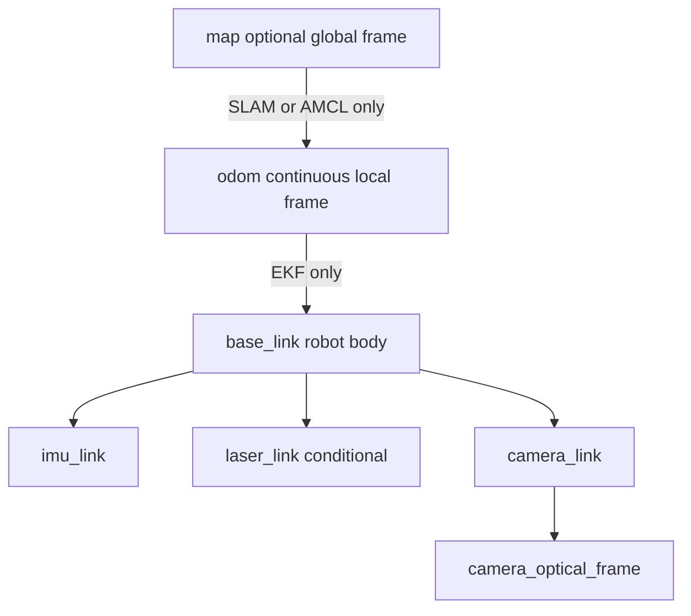

**Figure 3 ROS frame ownership.** In R1 the robot can operate without a map frame. For R2, choose either mapping with slam_toolbox or localization with AMCL as the map to odom owner; do not start both publishers for the same edge. [S8 S9]

Use metres seconds radians metres per second and radian per second in ROS. Body axes are x forward y left z up. Camera optical axes follow x right y down z forward. Apply a measured static transform for the camera and IMU mount. Do not label raw accelerometer counts as metres per second squared.

Convert MCU uptime to acquisition time through a maintained clock offset and measured uncertainty. Identify resets by boot ID, handle uptime wrap, and clear estimator history on reset. A stale frame is invalid rather than stamped with the current receive time. Keep MCU deadline calculations independent of clock conversion.

## 9 Overall dynamic design and end to end data flow

### 9 1 System mode state machine

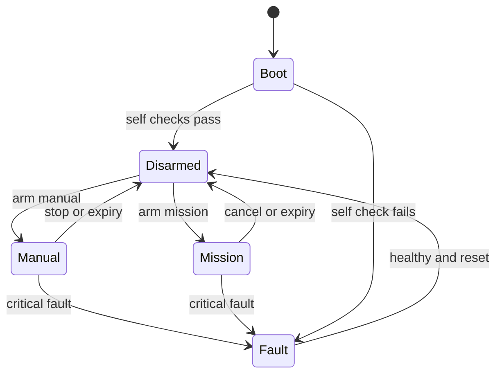

**Figure 4 Overall mode transitions.** Observation is available while disarmed. Manual and mission modes cannot transition directly into one another; takeover passes through a confirmed stop and a new lease. A fault reset clears the latch but does not arm motion.

### 9 2 Startup and readiness sequence

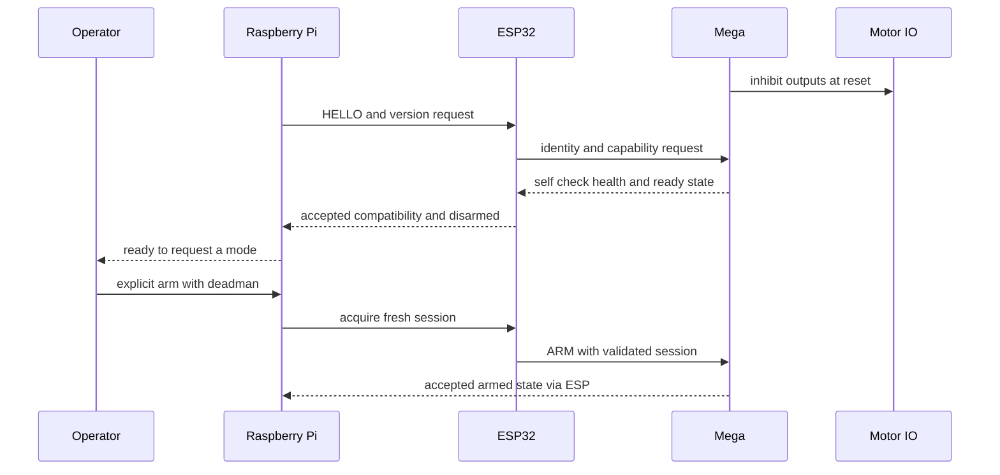

**Figure 5 Startup sequence.** A transport open event does not prove controller readiness. The acceptance response must include the actual Mega state. Missing responses leave the system disarmed and produce a visible diagnostic.

### 9 3 Manual command flow

An operator action becomes a timestamped intent on the Pi. The command selector accepts the intent only while its deadman is held and its lease is valid. The limiter applies speed and acceleration bounds. The collision monitor, when fitted and enabled, is downstream of velocity smoothing so no later smoother can reintroduce motion after a safety stop. The gateway converts the final safe velocity into protocol units. The ESP verifies session and ownership before forwarding it. The Mega validates the command, checks required direction relevant sensors, updates its local expiry timer and computes motor outputs.

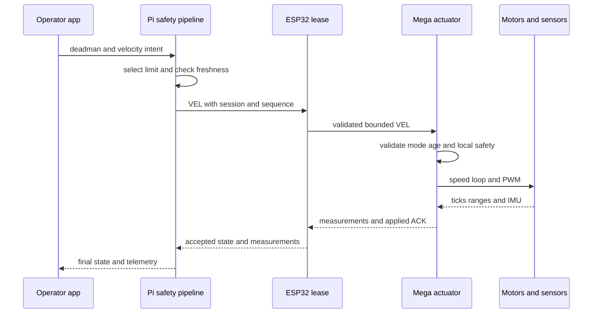

**Figure 6 End to end manual control.** The UI displays the accepted command and measured motion, which can differ from requested intent when limits or obstacle inhibition apply. [S10]

### 9 4 Camera assisted mission flow

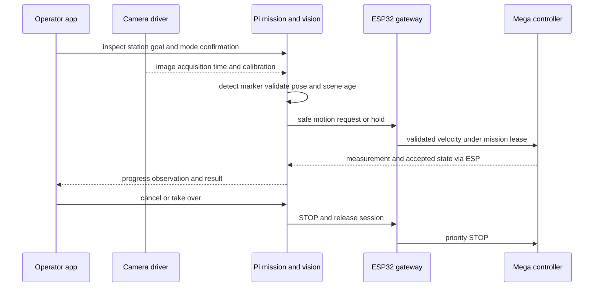

**Figure 7 Camera assisted mission.** For R1 the mission may follow an operator taught short approach in a controlled area or observe a station while stationary. Arbitrary waypoint movement requires the conditional navigation stack. Vision detections alone cannot authorize an unbounded path.

### 9 5 Loss and recovery flow

When the Pi host link closes, ESP immediately revokes the Pi lease and forwards STOP. If ESP is also unavailable, the Mega command age independently expires. When a fault clears, all controllers return to disarmed. A new identity exchange and explicit arm are necessary before motion resumes.

Measurements flow independently: acquisition on Mega, bounded transmission through ESP, timestamp conversion on Pi, unit conversion and validity checking, wheel odometry and EKF, mission or navigation consumers, then rosbag and operator display. A reboot invalidates the old measurement epoch. Camera frames travel directly from the camera driver to vision and the video bridge; they never traverse the MCU UART.

## 10 Raspberry Pi static and dynamic software design

### 10 1 Static package design

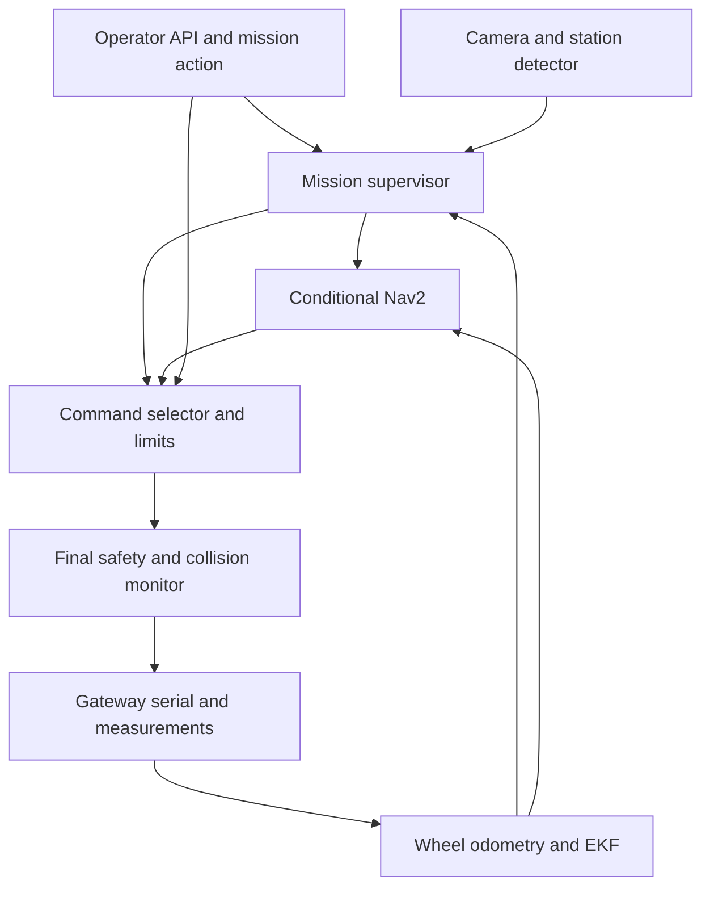

**Figure 8 Raspberry Pi static design.** The gateway subscribes to the final safe velocity only. Recording and diagnostics observe each package and are omitted from this figure to keep the command relationships readable.

| Package | Principal internal components | Input output and failure rule |
|---|---|---|
| asar_gateway | HostSerial Codec ClockAlign MeasurementAdapter StateMirror | Serial frames to typed measurements rejects old epoch stops on serial loss |
| asar_safety | CommandSelector ModeSupervisor FreshnessMonitor VelocityLimiter StopRouter | Selects one intent emits safe velocity zero and disarms on critical expiry |
| asar_localization | TickIntegrator EKF configuration GeometryStore | Counts and gyro to odometry rejects reset and implausible increments |
| asar_camera | UVCDriver CalibrationManager FrameHealth | Frames and CameraInfo stops camera dependent mission on stale frames |
| asar_vision | MarkerDetector PoseEstimator ObservationFilter | Calibrated frame to typed station observation invalid output has no motion authority |
| asar_mission | GoalValidator MissionFSM ActionServer OperatorSession | Validated goal to bounded intent and result accepts cancellation at every active phase |
| asar_navigation | MapManager Nav2 configuration localization adapter | Conditional maps scans and filtered odometry to bounded navigation intent |
| asar_bringup | Launch graph LifecycleCoordinator ConfigurationLoader | Ordered activation and diagnostics prevents arming if dependencies fail |

### 10 2 Runtime and concurrency design

Use C++ for the gateway and timing sensitive adapters; Python is suitable for mission logic tooling and the first vision prototype if measured load remains within budget. Keep the gateway safety and image processing in separate processes so image load cannot block serial reads. Use bounded queues with depth one or latest value replacement for images and velocity intent.

Start in the order configuration validation, robot model, gateway, measurement health, localization, camera, vision, safety, mission API, then conditional mapping or navigation. Deactivate in the reverse dependency order after publishing stop and confirming the Mega inhibit. Never let a node's ACTIVE lifecycle state substitute for current data validity.

| Work | Proposed rate or trigger | Budget and policy |
|---|---|---|
| Serial receive and frame validation | Event driven | Never block on image processing bounded parser work |
| Command output | 20 Hz | New valid safe command or explicit zero no backlog replay |
| Safety freshness and mode checks | 50 Hz | p99 cycle under 20 ms on combined load |
| Wheel odometry and EKF | 30 to 50 Hz | Measurement epoch and covariance verified |
| Vision inference | 10 Hz minimum target | Skip old frames latest image only |
| Mission supervisor | 10 Hz plus events | Cancel takes priority over next phase |
| Health and metrics | 1 Hz plus faults | Record CPU memory temperature storage and clock offset |

### 10 3 Pi dynamic lifecycle

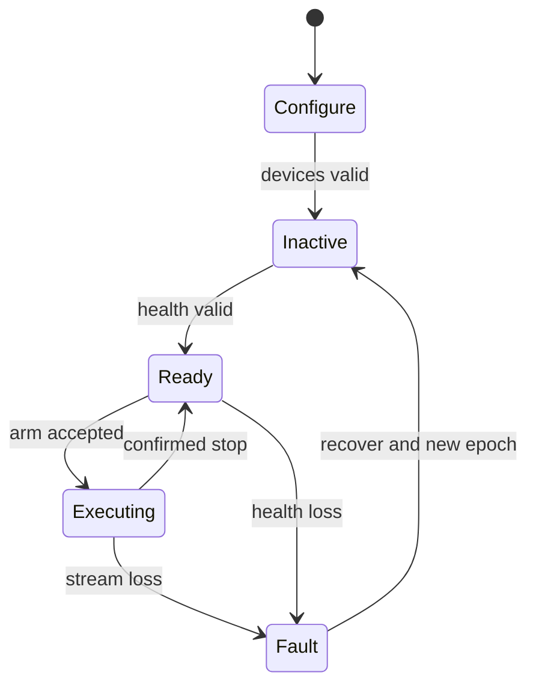

**Figure 9 Raspberry Pi runtime states.** The Pi keeps a mission log with mission ID goal requester configuration hash state transitions accepted command sequence fault reason and result. A camera or driver restart creates a new health epoch and cannot automatically resume an old mission.

### 10 4 Mission interface contract

The `ExecuteInspection` action includes a mission ID station ID allowed area maximum duration and optional approach policy. Feedback includes phase station confidence controller mode progress sensor freshness and inhibit reason. Results are SUCCESS CANCELLED REJECTED or FAILED with a reason code and evidence reference.

Validate the goal before acquiring motion: station ID must be known, requested speed must respect the operating profile, map dependent tasks require valid localization, and camera dependent tasks require fresh calibrated images. Store predefined station data in versioned configuration. UI input or a model output must not directly change motor limits.

## 11 ESP32 static and dynamic software design

### 11 1 Static modules

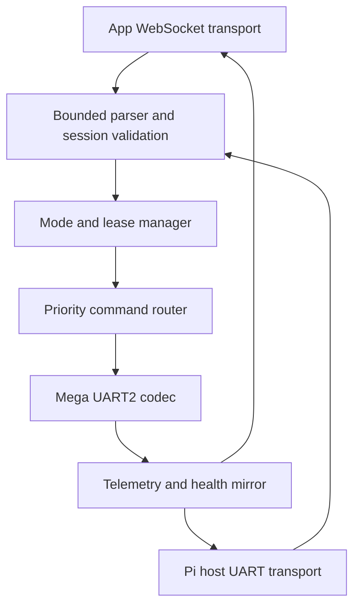

**Figure 10 ESP32 static design.** Every control transport goes through the same session and mode checks. UART2 output is a single writer. The host and app cannot compete through separate code paths.

| Module | Responsibility | Design rule |
|---|---|---|
| AppTransport | WebSocket connect disconnect bounded message input | Track each client actual close event and last valid intent |
| HostTransport | UART1 Pi frames identity and host health | Separate from USB logs and UART2 Mega link |
| FrameParser | Strict field count range CRC and size checking | Fixed bounded buffers reject overflow until next newline |
| SessionManager | Authenticate client validate session and message sequence | New sessions on reconnect no stale token acceptance |
| LeaseManager | One motion owner deadline and explicit transfer | Reads or PING do not renew motion ownership |
| CommandRouter | Stop first motion latest configuration allowed only in safe mode | Stop flushes queued motion and invalidates the lease |
| MegaLink | Identity request transmission ACK and state readback | No synthetic RDY no optimistic applied status |
| HealthMirror | Publish controller state timestamp and fault | Advertise unknown state as unknown rather than ready |

### 11 2 Dynamic mode and routing

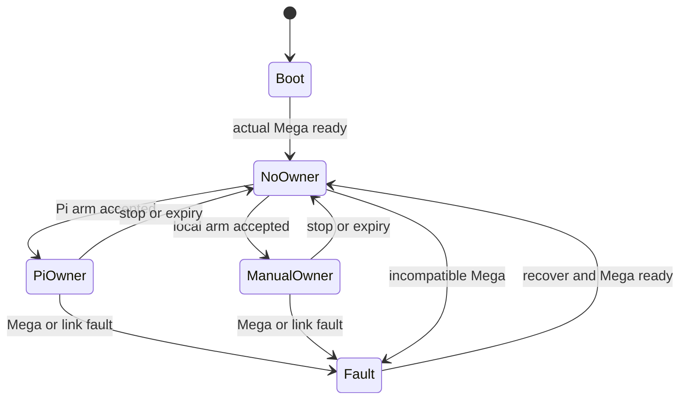

**Figure 11 ESP32 ownership states.** The stop route remains available in NoOwner and Fault states. Readiness is distinct from an open socket and from ownership.

Implement the first version as a cooperative loop with bounded input processing. If FreeRTOS tasks are introduced, create one transport writer queue and a separate priority stop signal. Shared mode and ownership data need explicit synchronization. A network callback must never directly write motor intent to UART without validation.

On socket close or host disconnect, record the owner lost reason, revoke the lease, discard pending velocities and send stop. WiFi reconnect attempts continue while disarmed. Rate limit malformed traffic and avoid dynamic String growth from arbitrary WebSocket payloads.

### 11 3 ESP acceptance checks

Inject two simultaneous control clients, malformed numbers, excess fields, oversized packets, a silent Mega, an ESP reboot, a disconnected owner and a flood of harmless PING frames. Confirm real readiness only, one owner, immediate stop routing, bounded memory and a visible reason for every rejected arm. A stop from an observer must reach Mega even while a valid owner is sending velocity.

## 12 Mega static and dynamic software design

### 12 1 Static modules

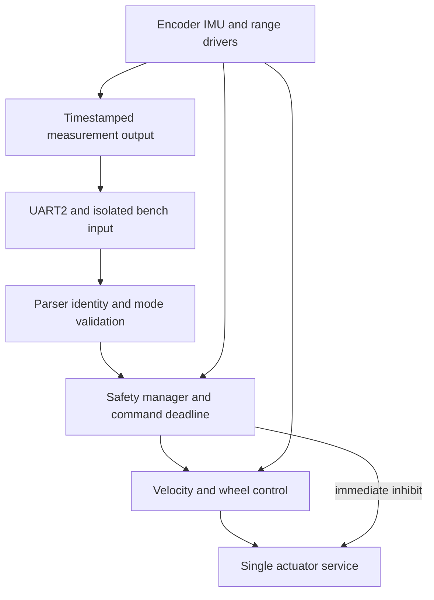

**Figure 12 Mega static design.** All PWM direction and enable writes belong to the actuator service. Legacy differential autopilot calibration and per wheel commands cannot bypass it.

| Module | Principal data | Rules and interfaces |
|---|---|---|
| ProtocolRx | Fixed receive buffer sequence session CRC | Parse before updating any valid motion timestamp |
| SafetyManager | Arm state cutoff contact command age sensor quality fault latch | Immediate output inhibit takes priority over ramping |
| EncoderDriver | Signed cumulative counts per feedback channel | ISR captures counts only atomic snapshots in scheduler |
| ImuDriver | Raw sample acquisition time scales validity | Bounded I2C timeout no quiet reuse of old sample |
| RangeDriver | Echo state acquisition time validity | Scheduled triggers avoid acoustic crosstalk no echo is unknown |
| WheelController | Requested and observed wheel speed integral saturation | Closed loop PI and antiwindup after characterization |
| ActuatorService | Four target and actual wheel states polarity and enable | Single write path sign reversal policy and hard inhibit |
| TelemetryTx | Snapshot sequence measurement epoch and quality | Bounded packet output debug traffic cannot starve control |
| CalibrationStore | Geometry encoder scale inversions gains and checksum | Validated configuration only changes while disarmed |

### 12 2 Dynamic control states

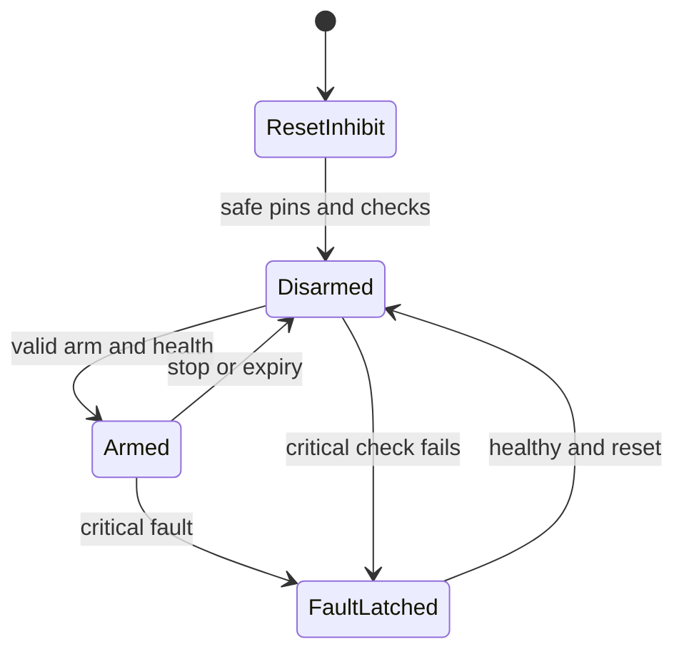

**Figure 13 Mega actuator states.** GPIO enable and PWM outputs become inactive before serial and sensor initialization. STOP and expiry force immediate zero output; the normal acceleration ramp applies only to valid ordinary motion.

### 12 3 Proposed cooperative schedule

| Function | Proposed cadence | Execution constraint |
|---|---|---|
| Cutoff contact deadline and stop handling | Every loop with a 10 ms target bound | Safety work precedes normal actuator update |
| UART parser | Every loop bounded byte count | Stop detection cannot wait behind diagnostic output |
| Speed control | 20 ms | Atomic count sample computation and actuator update |
| Encoder ISR | Each edge | No Serial I2C floating point or delay in ISR |
| IMU acquisition | 20 ms | Bounded I2C transaction declared sensor validity |
| Ultrasonic trigger scheduler | 20 ms slots | Front priority at 40 ms other sides interleaved measured freshness |
| Tick and IMU telemetry | 20 ms | Budgeted short frames |
| Range telemetry | Each completed sample or 10 Hz per direction | Include acquisition age and quality |
| Health state | 100 ms plus events | Fault messages prioritized |
| Slow diagnostic operations | Disarmed only | Never enter an active motion loop |

Capture normal and worst loop times on the AVR at maximum encoder pulse rate. The Mega has limited SRAM, so fixed buffers and short snapshots are preferred. Reject a design that only works with verbose debugging disabled if the required fault evidence is also lost; retain compact counters and state events.

Implement ultrasonic measurement as trigger, wait rise, wait fall, complete or timeout. If pin change capture is unavailable for the current echo pins, use bounded polling and prove detection at the minimum pulse width. A single monolithic `pulseIn` call should not remain in the accepted motion scheduler.

### 12 4 Legacy algorithm coexistence

Keep reactive autopilot in an explicit LEGACY_REACTIVE mode for regression or comparison. ROS mode disables local goal and cruise generators. Local obstacle inhibition remains active in every mode. If a valid owner sends a manual command, disarm the mission and stop before switching ownership rather than allow two algorithms to write targets.

For R1 the front and rear wheel targets on a side may share one measured side speed. The software still keeps four actuator states so inversion and output inhibition are consistent. Independent wheel speed feedback and holonomic control are conditional. Remove the current side averaging overwrite before exposing WSPD in an accepted release.

## 13 Algorithms and calibration

### 13 1 Algorithm selection

| Function | R1 selection | Conditional or later option | Validation focus |
|---|---|---|---|
| Manual mixing | Normalized differential mixer deadband and bounds | Holonomic mixer | Signs saturation and deadman |
| Motor regulation | Characterized feedforward plus PI wheel or side speed loop | Per wheel closed loop | Tracking stall detection and battery variation |
| Odometry | Differential count integration with measured scale and effective track | Mecanum forward kinematics | Distance turn error slip and reset |
| IMU processing | Bias calibration unit conversion modest low pass filtering | Improved IMU with magnetometer or external reference | Gyro bias yaw drift and mounting axes |
| State estimation | robot_localization EKF in planar mode | Visual inertial estimator after evidence | Covariance innovation consistency and TF ownership |
| Obstacle response | Direction relevant range checks measured braking envelope | LiDAR collision monitor and costmaps | Unknown data clearance and reaction time |
| Camera task | ArUco station recognition and calibrated pose estimate | Quantized semantic object detector | Held out recognition false positives and latency |
| Mapping | Not required for R1 | slam_toolbox 2D scan based SLAM | Loop closure map consistency and repeatability |
| Localization | Local odometry for R1 | AMCL on accepted saved map | Relocalization and pose loss handling |
| Navigation | Bounded supervised task approach | Nav2 grid planner and regulated pure pursuit differential controller | Route success footprint clearance and cancellation |

These choices are an implementation proposal. Select more complex algorithms only when a scenario demands them and a benchmark shows the additional compute and calibration cost is justified. [S8 S9 S11 S12]

### 13 2 Differential mixing and velocity conversion

For a normalized joystick use `left = throttle - turn` and `right = throttle + turn`, then divide both by `max(1, abs(left), abs(right))`. Define positive turn as positive yaw, verify actual wheel polarity and apply a centre deadband. Deadman release sends stop rather than merely ceasing UI updates.

For ROS body velocity, calculate `v_left = vx - b * wz / 2` and `v_right = vx + b * wz / 2`, where `b` is calibrated effective track width. Convert linear wheel speeds to angular setpoints with the measured radius. The Mega closed loop converts those setpoints to PWM. A linear multiplication of ROS velocity by 255 is not a speed controller.

Characterize each side over several PWM values, both directions and multiple battery states. Determine minimum sustainable motion, deadzone and achieved speed. Limit acceleration and enforce a zero crossing before changing direction under load. Keep emergency inhibit separate from comfortable ramping.

### 13 3 Encoder and odometry model

Measure counts per **wheel** revolution with the actual ISR edge mode. The current constant of 20 pulses per revolution is not sufficient evidence because the code interrupts on CHANGE of A and reads B for direction. Include gearbox ratio and verify the effective counts empirically.

For signed count differences `dnL` and `dnR`, use `dL = 2*pi*r*dnL/NL`, `dR = 2*pi*r*dnR/NR`, `ds = (dL+dR)/2`, and `dtheta = (dR-dL)/b`. Integrate position at the midpoint heading. Compare a measured straight run, reverse run, a full rotation and a square route against reference marks.

The current 65 mm wheel diameter and 150 mm wheel base are firmware constants, not a verified as built geometry. For a skid steering four wheel chassis calibrate an effective rotational track because wheel scrub can make it differ from the physical measurement. Increase estimator covariance when observed slip grows.

### 13 4 Speed loop tuning

Begin with proportional plus feedforward control, then add a small integral term to remove steady error. Bound the integral and reset it on disarm. Avoid adding derivative gain to quantized slow encoder measurements until the noise and rate are characterized. The existing heading PID and stability locks are not equivalent to independent closed loop wheel speed control.

Test a step speed command, a ramp, reverse transition, unequal side friction and a lightly restrained wheel with current limits. A blocked wheel fault should inhibit motion rather than increase PWM indefinitely. Record rise time steady error overshoot saturation and current; select gains from those results.

At low encoder resolution a 50 Hz count snapshot can contain zero or one new tick. It is a measurement delivery rate, not proof of equally frequent independent speed information. Use an adaptive edge period or a short count window for speed estimation and include its delay in the controller tuning. Upgrade feedback resolution if tracking cannot meet the accepted speed profile.

### 13 5 IMU conversion and EKF

Read and record the configured accelerometer and gyro scale registers. Convert values using the selected full scale range, subtract stationary gyro bias, and rotate data into `imu_link`. Estimate bias over a stationary interval with the final motor and cooling configuration. Do not use current threshold suppressed display telemetry as the only estimator input because it can hide small real rotations.

Start EKF with wheel forward velocity and calibrated gyro yaw rate in `two_d_mode`. Do not invent an absolute yaw from MPU6050 alone; it has no absolute heading reference. Do not double count wheel derived pose and velocity as independent evidence without accounting for their relationship. Disable gravity contaminated acceleration fusion until orientation and gravity removal are validated. [S8]

Tune covariances from recorded stationary and moving samples. Check turn direction and residuals before enabling navigation. A camera marker pose can be used as a separate station observation, but it should not be fed as global localization without a known marker map and frame transform.

### 13 6 Range processing and obstacle response

Trigger sensors in staggered slots, classify timeout as unknown, reject impossible values and use a short median filter only where its delay fits the braking budget. Record front measurement time separately from the aggregate DIST report time. A no echo value of zero must not be interpreted as a measured clear distance.

In manual forward motion require fresh front coverage; in reverse require rear coverage; in turning consider the swept footprint and side channels. Low confidence may force a reduced speed or disarm depending on the operating profile. Four ultrasound beams have blind spots and specular failures; the test area and speed limits must reflect those limitations.

The conditional LiDAR stack feeds both the costmap and a final collision monitor. Configure the measured footprint, sensor transform and stop polygons from the braking envelope. An operator may cancel motion at any time. Automatic recovery motions need their own coverage and time limit, especially reversing. [S10]

### 13 7 Camera station recognition

Use an ArUco dictionary with recorded marker IDs and measured printed side length. Calibrate intrinsics from diverse image positions and orientations, then estimate pose with known marker geometry. Keep exposure and focus consistent during calibration and pose tests. Mount vibration, rolling shutter and lighting must be included in the dataset. [S11]

Require several consistent detections before declaring a station acquired. Use confidence age and pose bounds to reject stale or implausible results. For R1 station recognition reports ID and relative pose and can support a bounded low speed approach only after independent obstacle checks. The camera does not provide guaranteed collision coverage.

Separate training or tuning images from acceptance sequences by recording session, not by random adjacent frame split. If a semantic detector is added, choose the smallest model that satisfies the declared classes and Pi latency budget. Record licence model checksum precision recall false detections FPS memory and p95 latency. A claim of object detection accuracy must name the dataset and operating conditions.

### 13 8 Conditional mapping and navigation

Use a supported scanning 2D LiDAR publishing calibrated LaserScan data, wheel and IMU odometry, and slam_toolbox for map creation. Save both the occupancy map and required mapping state with configuration hashes. Use AMCL for saved map navigation, or a deliberately selected slam_toolbox localization mode, with one map to odom publisher. [S9]

Begin Nav2 with a grid based global planner and a differential compatible regulated pure pursuit controller. Configure footprint inflation speed acceleration and goal tolerances from measurements. Use conservative recovery policies: pause replan and ask for operator help before allowing unattended reverse or spins in a narrow area. Confirm plugin names and parameter schemas against the installed Jazzy release. [S12]

R2 acceptance requires valid localization at startup, fresh scans, successful map save and load, pose loss detection and repeated waypoint completion. A single central rangefinder or the current UART byte dump sketch does not provide a scan suitable for 2D SLAM.

### 13 9 Conditional Mecanum model

If physical inspection confirms an X roller arrangement and independent wheel feedback is installed, define body x forward y left z up with wheel radius r and `k = half_length + half_width`. The candidate wheel angular velocities in the current WSPD wire order are:

```text
FL = (vx - vy - k*wz) / r
RL = (vx + vy - k*wz) / r
FR = (vx + vy + k*wz) / r
RR = (vx - vy + k*wz) / r
```

Verify this sign convention against the actual roller and wheel orientation with lifted wheel tests followed by low speed floor translation. Scale all four commands together when one saturates. Add per wheel controllers and a forward kinematic estimator from all four encoders. Choose a holonomic Nav2 controller only after sideways movement odometry and footprint tests pass. R1 continues to reject `vy`.

## 14 Camera and ROS integration procedure

### 14 1 Initial camera path

Select a USB UVC camera as the first Ubuntu integration path. Use the maintained ROS `usb_cam` driver with a checked configuration for device pixel format width height frame rate and camera frame. A stable `/dev/v4l/by-id` path is preferred to an assumed `/dev/video0`. [S13]

```bash
v4l2-ctl --list-devices
v4l2-ctl --device <camera-device> --list-formats-ext
sudo apt install -y ros-jazzy-usb-cam
ros2 run usb_cam usb_cam_node_exe --ros-args --params-file <camera-yaml>
```

WP05 creates the camera YAML and wraps this in `asar_camera` launch files. Set 640 by 480 and 15 to 30 FPS initially. Select a supported pixel format from the device rather than hardcode one. Confirm image timestamps calibration and frame ID before connecting vision.

For a Raspberry Pi CSI camera use modern libcamera and the appropriate bridge. Picamera2's officially supported OS is Raspberry Pi OS, so installing it on Ubuntu must be treated as a compatibility experiment rather than the standard ROS setup. Switching to Raspberry Pi OS with a ROS container is a separate platform decision with device access and clock tests. Do not assume an apt Picamera2 command on Ubuntu produces the same supported configuration. [H4 S14]

### 14 2 Calibration and image health

1. Secure the final mount and measure camera height tilt and relation to base_link.
2. Lock the lens or autofocus setting used for pose estimation and select a reproducible resolution.
3. Capture checkerboard or ChArUco images across the full field of view and depth range.
4. Save intrinsics distortion image dimensions and a calibration ID in a versioned file. A proposed initial target is RMS reprojection error below 1 pixel, followed by physical pose checks.
5. Check optical frame orientation and a known marker at several measured distances.
6. Test unplug reconnect frozen frames camera busy wrong resolution and low light. A camera process that is running without new frames is unhealthy.
7. Recalibrate after lens resolution or mount changes and record the applicable hardware revision.

### 14 3 Inspection stream and operator integration

Use a separate image stream from the control socket. A ROS `web_video_server` MJPEG bridge is a practical first LAN prototype; benchmark it against the inspection latency and bandwidth target. If it fails the budget, select a measured WebRTC or encoded stream implementation before release. Keep a current acquisition time or frame age in the displayed feed and show stream unavailable on expiry. [S15]

The Pi operator API supplies mode controller ownership readiness fault and mission status. The app should show requested intent accepted intent measured speed and video age without presenting a connected socket as proof of a ready robot. Deadman release STOP and mission cancellation remain immediately accessible.

For the first LAN stream prototype install and launch the verified ROS package:

```bash
sudo apt install -y ros-jazzy-web-video-server
ros2 run web_video_server web_video_server --ros-args \
  -p port:=8080 -p default_qos_profile:=sensor_data
```

The prototype stream path is `http://<pi-ip>:8080/stream?topic=/asar01/camera/image_raw&type=mjpeg`. Remap the camera image topic to this name in bringup and validate producer and subscriber QoS. This local prototype requires the external access protections in Chapter 17 before any remote exposure.

### 14 4 Ordered integration gates

First run ROS without motors using a serial simulator. Next connect the Pi to ESP and Mega with lifted wheels. Verify identity mode and packet timestamps. Add wheel and IMU output then local odometry and frame checks. Add camera and stationary station recognition. Validate manual inspection at low speed. Enable bounded camera task motion only after local obstacle and timeout tests pass. Introduce LiDAR mapping and Nav2 last, as a conditional increment.

## 15 Testing setup and verification strategy

### 15 1 Test layers

Verification progresses from portable logic to electrical integration and complete user scenarios. Keep the existing subsystem sketches as bringup tools, and extend the repository's T01 to T20 acceptance material to the actual WebSocket app path. Those existing test documents describe procedures; they are not evidence of executed tests. [P9]

| Layer | Environment | Tests and evidence |
|---|---|---|
| Unit | Host compiler Python and browser runner | Strict parsing CRC sequence wrap arithmetic limits scheduler decisions and UI state |
| Software integration | Simulated serial WebSocket peers and ROS launch tests | Producer consumer contracts modes queue ownership clock alignment and reset |
| Recorded replay | Fixed sensor bags camera sequences and packet traces | Estimation perception and fault response against a known dataset |
| Simulation | Gazebo Harmonic robot model with sensors | Startup drive obstacle navigation and cancellation without physical risk |
| Component bench | Isolated MCU and sensor sketches | Motor polarity encoder scale sensor axes echo quality UART levels |
| HIL | Complete controller chain with lifted wheels | Fault injection real timing saturation output inhibit and restart |
| System verification | Low speed marked floor area | Requirement based motion camera task telemetry and endurance |
| User validation | Representative users performing inspection tasks | Useful outcome usability confidence and effort compared with the baseline |

### 15 2 Bench and HIL setup

Prepare a stable stand that keeps all wheels off the floor, a current limited supply, an accessible cutoff, a DMM and a logic analyser. Connect probes to at least one motor enable, direction signal, ESP to Mega UART, and the cutoff auxiliary input. An oscilloscope is needed for rail transients and precise enable timing. Use USB isolated equipment where ground loop assessment requires it.

Give each ECU and serial adapter a stable device identifier. One process owns each serial port. Capture raw UART traffic through a high impedance sniffer where possible rather than opening a second conflicting serial writer. The HIL harness must support explicit STOP in teardown and always leave the robot disarmed after failure.

Create fixtures for no Mega response, bad CRC, oversized line, partial frame, old session, sequence wrap, reset, packet delay and traffic flood. Use a switchable camera or deliberate process freeze to test frame freshness. Use a removable sensor connector or driver fixture for sensor loss. Never inject a short circuit to emulate an ordinary data fault.

### 15 3 Proposed automated test commands

The following commands are project additions to implement in WP01 and WP07. They document the intended verification entry points rather than existing scripts.

```bash
cmake -S tests/unit -B build/unit
cmake --build build/unit
ctest --test-dir build/unit --output-on-failure
python -m pytest tests/hil --profile lifted-wheels
```

For the mobile application add `test`, `test:e2e` and meaningful lint rules. For the backend add a test runner covering leadership stop session and explicit physical transport behaviour. For ROS use colcon tests plus launch tests and bag replay. Every automatic hardware test starts with a known disarmed state and ends with STOP and confirmation of zero output.

### 15 4 Verification catalogue

| Test ID | Focus | Procedure and pass condition |
|---|---|---|
| VT01 | Electrical and pin continuity | Verify labelled harness polarity translator levels and driver channels against Chapter 5 |
| VT02 | Safe startup | Ten power or reset cycles no motor enable before arm real Mega readiness only |
| VT03 | Missing controller | Start Pi or ESP with Mega absent no synthetic RDY arm rejected |
| VT04 | Physical cutoff | Interrupt motor energy at low speed independently of software measure timing and retained fault |
| VT05 | Software STOP | Stop from owner and observer during forward reverse and turn enable zero within NFR03 |
| VT06 | Command expiry | Stop valid motion then flood PING telemetry reads and bad frames motion still expires |
| VT07 | Ownership | Two apps and Pi compete only the valid owner renews motion explicit stop before transfer |
| VT08 | Parser and framing | Partial lines noise bad CRC extra fields out of range and 96 byte boundaries reject safely |
| VT09 | Reset and sequence | Old boot packets duplicates out of order and counter wrap do not replay motion |
| VT10 | Motor mapping | Each channel forward reverse and zero matches FL RL FR RR labels and inversion configuration |
| VT11 | Encoder count scale | Ten measured wheel revolutions per channel signs and counts match documented conversion |
| VT12 | Speed regulation | Speed steps ramps reversal and unequal friction meet selected tracking and current limits |
| VT13 | IMU | Static bias mounting axes unit conversion and yaw sign match reference movements |
| VT14 | Range safety | Close targets no echo frozen values crosstalk and reversed sensor labels produce correct inhibition |
| VT15 | Local odometry | Straight reverse full turn and square route errors recorded calibrated geometry accepted |
| VT16 | TF and QoS | One dynamic owner per edge correct frame axes compatible QoS and reset handling |
| VT17 | Camera capture | Resolution rate timestamp calibration link and video age meet NFR07 |
| VT18 | Camera fault | Unplug freeze restart and changed resolution pause dependent mission without automatic resume |
| VT19 | Station detector | Held out lighting distance angle and occlusion sequences meet SC03 criteria |
| VT20 | Mission lifecycle | Reject invalid goal accept valid goal cancel at every phase report result and stop |
| VT21 | Link faults | Pi host ESP UART2 app disconnect and service kill satisfy NFR04 |
| VT22 | Load and endurance | Combined camera ROS traffic and motors 30 minutes meet NFR09 NFR10 and NFR11 |
| VT23 | Build and compatibility | Clean build manifests checksum match unsupported ECU version prevents arm |
| VT24 | Relay separation | Hardware simulation and bench transport explicit no automatic physical fallback or handover motion |
| VT25 | App lifecycle | Background screen lock reconnect deadman release and stale display stop or disarm correctly |
| VT26 | Hub workflow | Schema parity identity permissions concurrent task updates and evidence validation |
| VT27 | Map and localization | Conditional scan transform map save load relocalization and pose loss detected |
| VT28 | Navigation | Conditional waypoint route blocked path recovery and cancel satisfy SC05 |
| VT29 | Holonomic drive | Conditional four encoder signs forward sideways and rotation match measured pose |
| VT30 | Recovery and rollback | Previous accepted image reinstalled calibration matched system disarmed and tests reproducible |
| VT31 | Product usefulness | Representative users complete inspection and camera task with measurable outcomes |

Unit tests should target behavioural boundaries rather than duplicate implementation. For example, a malformed command must not update a valid motion timestamp; a test that merely calls the same parser and repeats its current output would not establish that requirement.

### 15 5 Measurement and acceptance records

Every run records test ID requirement IDs operator date robot hardware revision battery state software commits firmware versions configuration and calibration hashes fixture description steps expected result observed result logs and verdict. Include raw timing captures for stop and expiry tests. A screenshot of an ACK alone does not prove motor output stopped.

Maintain separate verdicts for command accepted, actuator inhibited and physical wheel stopped. Use high speed video or an encoder trace to measure coast distance. Tie the braking envelope to the measured floor payload and battery conditions. Sensor validity flags and clock uncertainty should be preserved in bags.

### 15 6 Regression and release selection

Run parser mode and stop unit tests for every firmware change. Run the relevant source to sink integration test after a protocol change. Run full safety HIL after any change to motor routing deadline sensor processing or power hardware. Replay the accepted camera and odometry datasets after algorithm tuning. Repeat a complete scenario only when a changed dependency can affect it or a release candidate needs acceptance evidence.

Release blockers include uncontrolled motion false readiness an ineffective cutoff timeout bypass concurrent motion writers corrupted units and unhandled stale safety data. Functional limitations that stay within the declared release scope can be documented, but mandatory requirements cannot be waived through a successful demonstration.

## 16 Core user scenarios and idea validation

### 16 1 SC01 Safe first use

**Purpose.** A new operator should be able to start the robot and understand whether it is ready before moving it.

**Preconditions.** Approved harness battery and software configuration. Motors lifted for first execution. No session is armed.

**Procedure.** Power the robot in different ECU orders, open the app, verify reported identities, try motion before arm, request arm with deadman, release deadman, then disconnect and reconnect. Repeat the power sequence with Mega absent and with an incompatible firmware version.

**Acceptance.** Zero unintended motor enable in ten boot trials and ten reconnect trials. Motion before valid arm is rejected. Missing or incompatible Mega prevents ready and arm. Reconnect returns to disarmed. Capture startup logs PWM traces and the app's final status. Tests VT02 VT03 VT09 VT23 VT25 apply.

### 16 2 SC02 Remote visual inspection

**Purpose.** Test whether live video and telemetry let an operator inspect an area without standing beside the robot.

**Preconditions.** Mandatory safety tests pass. A marked indoor route of approximately 10 metres contains three inspection objects and no people in the robot path. Local video is calibrated and meets NFR07.

**Procedure.** The operator drives the route from a position where the objects are not directly visible, stops at each object, records its label or condition, then returns to the start. Include forward reverse and a turn. Use five representative users after a short standard introduction.

**Acceptance.** At least 19 of 20 repeated route runs complete without contact or intervention caused by uncontrolled behaviour. At least 90 percent of defined inspection observations are correct. Record elapsed time STOP use video age operator errors and missed observations. No safety failure is permitted. Tests VT05 VT10 VT14 VT17 VT22 VT25 VT31 apply.

### 16 3 SC03 Camera assisted inspection station

**Purpose.** Validate that a camera task adds useful information or reduces steering effort.

**Preconditions.** A known 100 mm marker is fixed at a labelled station. Use held out recording sessions at 0.5 to 2.0 metres, within an initially proposed lighting range of 100 to 500 lux. The exact marker dictionary and print scale are recorded.

**Procedure.** Request station observation, vary the approach angle within plus or minus 30 degrees, repeat with partial occlusion and an unknown marker, and request cancellation during acquisition. A bounded approach is tested only after local obstacle and command timeout acceptance.

**Acceptance.** Correct station ID in at least 19 of 20 valid visibility trials. No false mission completion in 20 unknown marker or occlusion trials. Median stationary range error at most 0.10 m over the defined 0.5 to 2.0 m range, subject to final calibration feasibility. A cancellation inhibits output within NFR03. Save images detections ground truth and mission results. Tests VT17 VT18 VT19 VT20 VT31 apply.

### 16 4 SC04 Obstacle encounter

**Purpose.** Validate that sensing and the stop chain constrain motion rather than merely display warnings.

**Preconditions.** Braking envelope measured. Low speed commissioning profile selected. Use rigid targets and safe fixtures rather than a person walking into the path.

**Procedure.** Introduce a target in forward and reverse paths, then near the swept turn footprint. Repeat with no echo stale range and a frozen but plausible range. Check that the correct direction relevant channel is required.

**Acceptance.** Twenty of twenty encounters end without contact. Minimum clearance meets the configured measured envelope; record the observed value rather than assuming the initial 0.30 m threshold. Invalid required coverage inhibits the corresponding motion. Automatic reverse is unavailable when rear coverage is invalid. Tests VT04 VT05 VT06 VT14 VT21 apply.

### 16 5 SC05 Conditional mapped waypoint mission

**Purpose.** Test autonomous navigation usefulness after scanning LiDAR and localization are accepted.

**Preconditions.** Approved scanning LiDAR map and localization settings. R1 safety tests pass. A measured arena has three waypoints, a narrow passage and a removable obstacle. The robot model matches the actual chassis.

**Procedure.** Load the saved map, localize, request a three waypoint mission, block one route, cancel a mission, and deliberately invalidate localization. Repeat starting from several accepted poses.

**Acceptance.** At least 18 of 20 missions reach all waypoints within a proposed final position tolerance of 0.20 m and heading tolerance of 10 degrees. Zero contacts. Blocked path produces a safe pause or bounded replan. Localization loss inhibits autonomous motion. Save bags maps route outcomes and pose references. Tests VT16 VT27 VT28 apply. Failure to procure a supported scanning LiDAR defers this scenario and R2 rather than relabels it as R1 acceptance.

### 16 6 SC06 Operator takeover and observer control

**Purpose.** Validate that responsibility can move between operator and autonomy without conflicting motion.

**Procedure.** Run a valid mission while a second app observes. The observer tries arm and motion, then requests STOP. The operator requests takeover. Disconnect the owner while the observer remains connected, then reconnect the owner.

**Acceptance.** Observer motion is rejected and observer STOP succeeds. Every transfer contains a confirmed zero output and a new lease. Closing the owner does not promote another client into moving control. Reconnecting does not replay previous intent. Tests VT05 VT07 VT09 VT24 VT25 apply.

### 16 7 SC07 Controller and communication loss

**Purpose.** Prove the stop path works when the ordinary command path is unavailable.

**Procedure.** During low speed lifted wheel motion disconnect the Pi host cable, kill the mission process, disable WiFi, disconnect UART2 and reset each ECU separately. After the last accepted motion command, flood PING or malformed packets. Repeat ten times per fault class.

**Acceptance.** All trials inhibit output within NFR04. Each fault is visible and recorded. Healthy recovery returns to disarmed and requires explicit arm. PING and invalid commands cannot extend motion. Physical coast time and distance remain separate measurements. Tests VT06 VT08 VT09 VT21 VT30 apply.

### 16 8 SC08 Camera loss and resource overload

**Purpose.** Validate the relationship between perception health and the requested task.

**Procedure.** Unplug the camera during inspection, freeze capture without killing its process, create CPU load, fill the log volume to its low space threshold and reconnect the camera with another resolution.

**Acceptance.** The UI shows stale or unavailable video. A camera dependent task pauses or fails safely within the declared frame freshness limit. Critical controller traffic remains within NFR04. Recovery does not resume a task automatically. Navigation without camera may continue only under a separately defined camera independent mission profile with required LiDAR and localization health. Tests VT18 VT20 VT22 VT25 apply.

### 16 9 SC09 Reproducible release and evidence

**Purpose.** Demonstrate that another developer can reproduce and maintain the accepted system.

**Procedure.** A developer follows only this plan and the repository setup files on a clean environment, builds all parts, installs the release image, loads the recorded calibration, runs startup and stop checks, and publishes the test result link to a staging Team Hub task.

**Acceptance.** Build and release manifests identify matching versions and checksums. A configuration or ECU mismatch prevents arm. The staging task records the correct evidence and authorized actor. The previous accepted release can be restored while remaining disarmed. Tests VT23 VT26 VT30 apply.

### 16 10 SC10 Product validation measures

Agree success thresholds before running the user sessions. Proposed initial criteria are inspection observation accuracy at least 90 percent, at least four of five users completing the standard task after the same introduction, and a usability rating of at least four out of five for understanding ready stopped and fault states. Compare camera assisted task completion time and steering interventions with the same user's manual baseline. A proposed useful improvement is at least 25 percent fewer steering interventions without worse observation accuracy or safety.

Report median values failure counts and operating conditions. Five users provide an initial usability signal, not population level proof. If station recognition works technically but does not improve task completion, revise the mission or user interaction before adding a larger model. Accept the project idea on useful repeatable task outcomes rather than the presence of ROS or AI components.

## 17 Safety faults security and recovery

### 17 1 Hazard and control register

| Hazard | Trigger | Required control | Verification |
|---|---|---|---|
| Motion after operator loss | Stale socket flag or heartbeat | Independent valid command deadline revoke lease on disconnect | VT06 VT21 |
| False readiness | Timed assumed RDY | Actual identity health and Mega ready response only | VT03 |
| Competing actuation | Pi app local autopilot or bench USB | One owner one actuator writer explicit modes | VT07 VT24 |
| Bypass of inhibit | Direct WSPD output | Common actuator service state validation and immediate inhibit | VT05 VT10 |
| Collision after blind sensor | No echo stale range or camera image | Validity per task direction coverage and measured envelope | VT14 VT18 |
| Wrong motion from frame error | Sign inversion scale or transform | Calibration known moves frame ownership and unit tests | VT11 VT13 VT16 |
| Reset replays motion | Cached velocity or retained intent | New boot and session identity disarmed restart | VT09 |
| Electrical damage or reset | 5 V GPIO wrong polarity motor EMI | Level translation rated supplies wiring and power checks | VT01 VT22 |
| Excessive braking distance | Speed battery payload or floor variation | Measured minimum deceleration conservative profile physical cutoff | VT04 VT12 |
| Invalid remote user | Unauthenticated relay control | Authenticated session server authorization bounded lease | VT07 VT24 |

### 17 2 Fault response matrix

| Fault | Immediate response | Recovery condition |
|---|---|---|
| Physical cutoff open | Motor energy removed Mega observes and latches fault | Hardware restored self check and explicit reset then arm |
| Mega timeout | Force enable zero invalidate arm emit fault | New session readiness and explicit arm |
| Pi host lost | ESP revoke stop Mega deadline independently expires | Fresh host identity and explicit arm |
| UART2 lost | ESP reports Mega unavailable Mega own deadline expires | Valid link actual Mega readiness and new session |
| Owner app lost | Revoke lease stop do not promote moving owner | Explicit selection of a new owner and arm |
| IMU stale | Inhibit modes that require IMU bounded manual profile only if separately validated | Fresh calibrated stream and estimator reset as needed |
| Encoder invalid | Inhibit closed loop and autonomy no silent PWM fallback | Repair and calibration check |
| Direction relevant range invalid | Inhibit motion into that sector | Fresh valid coverage and explicit resume |
| Camera stale | Stop camera dependent mission show missing feed | Healthy frames matching calibration new task confirmation |
| LiDAR stale or localization invalid | Stop mapped autonomy | Healthy scan and relocalization then explicit mission restart |
| CPU or storage overload | Drop old images stop recording safely maintain command deadlines pause if timing fails | Metrics recover with no automatic arm |
| Bad packet or protocol mismatch | Reject packet do not refresh motion reject arm on mismatch | Valid compatible session |

### 17 3 Security and team data

Treat the current plain WebSocket path as a controlled local development interface. For external relay use TLS an authenticated connection authorized roles rate limiting bounded packets and a visible remote session owner. Keep safety decisions local because internet latency or authentication service loss cannot replace the Mega deadline.

Move WiFi credentials and API keys into untracked local configuration or device provisioning. Rotate values already exposed in tracked files. Review repository history and avoid publishing personal phone email or learning assessment details in documentation fixtures. Camera recordings should use the agreed test area and consent process for identifiable participants.

Team Hub administrative actions must derive the actor from a verified server session and check privileges at the backend. A browser role dropdown is not authorization. Remove the production fallback test identity, validate input, protect concurrent writes with the appropriate lock, and separate staging from the live spreadsheet. Add an audit event for task status evidence and deadline changes.

### 17 4 Operational runbook

Before each run inspect wiring mount stability wheel clearance battery condition storage and current calibration. Power logic, verify disarmed health, test cutoff, then enable motor energy. Select one operator and one mode. Begin at the low speed profile and confirm stop response before a scenario.

After each run stop disarm confirm output zero save the evidence manifest and shut down the Pi before removing its supply. Investigate unexpected motion as a release blocker. Update the hazard record with the trigger versions trace and corrective verification.

## 18 ARCI responsibilities and team operation

### 18 1 Role definitions

ARCI means **Accountable Responsible Consulted Informed**. Each activity has one accountable role. Responsible roles perform the work, consulted roles review affected decisions, and informed roles receive the outcome. Role assignments below are proposed; the team lead assigns named members at G0 without changing the accountability model.

| Code | Role | Responsibility |
|---|---|---|
| SL | System lead | Scope interfaces architecture decisions and release accountability |
| HW | Hardware lead | Harness power chassis sensor installation and electrical evidence |
| FW | Firmware lead | ESP Mega protocol actuator and sensor implementation |
| RO | ROS and vision lead | Pi ROS estimation perception mission and conditional navigation |
| UI | Application lead | Mobile app operator API relay and connection experience |
| QA | Verification lead | Test design fixtures independent evidence and acceptance recommendation |
| HB | Team Hub lead | Dashboard staging data permissions work and evidence tracking |

### 18 2 ARCI matrix

| Activity | SL | HW | FW | RO | UI | QA | HB |
|---|---|---|---|---|---|---|---|
| Scope and acceptance | A | C | C | C | C | R | I |
| System architecture | A R | C | C | C | C | C | I |
| Hardware BOM and power | A | R | C | C | I | C | I |
| Pin and harness baseline | A | R | C | C | I | C | I |
| Protocol and ownership | A | C | R | C | C | C | I |
| ESP and Mega software | A | C | R | C | C | C | I |
| Pi ROS and camera | A | C | C | R | C | C | I |
| Mobile and relay | A | I | C | C | R | C | I |
| Unit and integration checks | A | C | R | R | R | C | I |
| HIL and system verification | A | C | C | C | C | R | I |
| User validation | A | I | I | C | R | R | I |
| Hub permissions and evidence | A | I | I | I | C | C | R |
| Release manifest and rollback | A | C | R | R | R | C | C |
| Acceptance recommendation | A | C | C | C | C | R | I |

The accountable system lead may decline acceptance when independent verification identifies a blocker. The firmware or ROS contributor should not be the only person judging their own safety result.

### 18 3 Controller design ownership

FW owns both MCU implementations and the shared protocol. RO owns the Pi packages and ROS contract. HW owns the physical signal and power map. SL approves changes crossing those boundaries. QA owns the source to sink validation evidence. UI owns how an operator sees readiness accepted commands faults and cancellation, with RO and FW consulted for semantics.

### 18 4 Team Hub operation

Use existing Task fields for title description definition of done assignees status ETA ATA and review feedback. Include stable work package requirement and test IDs in the task description and a link to the source PR. Store evidence links in the supported evidence field or a versioned evidence index; add a schema migration if a dedicated task field is required rather than inventing columns in production.

Maintain an engineering record with requirement ID work package owner source commit test run verdict evidence URI and review date. The Hub can display this record, but source control remains authoritative for requirements and interfaces. Local workbook and CSV fixtures must follow the repository synchronization mandate.

### 18 5 Working cadence and training

Use a weekly technical integration review and a short evidence review before each gate. Review interface changes before parallel implementation so ESP Mega Pi and app contributors do not discover incompatible assumptions at hardware integration.

| Training track | Participants | Required practical outcome |
|---|---|---|
| Git build and review | All contributors | Reproduce a build create a reviewed change and identify its release versions |
| Embedded sensing and safety | HW FW QA | Demonstrate pin checks encoder scale and an independent stop trace |
| Linux ROS and frames | RO FW QA | Launch the robot graph identify units and replay a sensor bag |
| Camera calibration and perception | RO QA UI | Produce a calibration report and held out station detection result |
| Operator and API behaviour | UI RO QA | Demonstrate deadman lease takeover cancellation and stale state display |
| Hub staging and data | HB QA | Verify local parity backend permissions and evidence linkage |

Track training as completed only when the practical outcome is demonstrated. Avoid allowing training attendance alone to close an engineering work package.

## 19 Work packages schedule and release gates

### 19 1 Capacity and planning assumptions

The calendar below interprets this year as the remaining 2026 calendar year. It starts on Monday 12 October and ends on 31 December. It assumes available hardware procurement during the first two weeks and contributors covering the seven roles, with some people holding more than one role. These are planning assumptions rather than known staffing commitments.

The estimated mandatory effort is roughly 70 to 100 person days across firmware ROS app hardware and verification, excluding major mechanical replacement. A team of five contributors averaging two focused project days each per week can provide about 110 person days over eleven weeks. The team must confirm capacity at G0. Reduce conditional work first if actual capacity is lower; do not reduce safety acceptance to protect the date.

### 19 2 Work package backlog

| ID | Work package and deliverable | Lead | Dependency | Effort range |
|---|---|---|---|---|
| WP00 | As built BOM geometry harness scope and operating profile | SL HW | None | 4 to 6 days |
| WP01 | Toolchain lock secrets cleanup build commands CI and regression harness | FW UI HB | WP00 baseline | 6 to 8 days |
| WP02 | Protocol v2 ready checks mode ownership command deadline and common actuator inhibit | FW | WP00 WP01 | 12 to 16 days |
| WP03 | Pi image host UART ESP adapter power and serial health | RO FW HW | WP00 interface agreed | 5 to 7 days |
| WP04 | ROS workspace URDF ticks IMU local odometry EKF and recording | RO | WP02 WP03 | 10 to 14 days |
| WP05 | USB camera driver calibration stream and station detector | RO UI | WP03 | 8 to 12 days |
| WP06 | Operator API inspection action cancel takeover and accepted state display | RO UI | WP02 WP04 WP05 | 8 to 12 days |
| WP07 | Unit integration HIL fault timing and scenario evidence | QA with contributors | Begins WP01 spans all increments | 12 to 18 days |
| WP08 | Hub staging permissions task evidence and parity checks | HB | WP01 data and evidence schema | 4 to 6 days |
| WP09 | Conditional LiDAR SLAM localization and Nav2 waypoints | RO HW | G3 and approved scan hardware | 12 to 18 additional days |
| WP10 | Release candidate endurance clean build rollback and handover | SL QA | G4 mandatory acceptance | 5 to 7 days |

The ranges overlap with integration and review work; sum them only as a first capacity estimate and replace them with team estimates at G0. Four wheel Mecanum development and an edge language model are separate optional packages, with no committed year end delivery in this baseline.

### 19 3 Calendar plan

| Window | Mandatory focus | Parallel work | Gate or output |
|---|---|---|---|
| 12 to 18 October | WP00 inventory hazards scope geometry and harness | Procure Pi camera adapter translator and power components | G0 scope hardware and capacity agreed |
| 19 to 25 October | WP01 reproducible builds WP02 stop ready and deadline design | WP03 Pi image and electrical bench WP08 staging setup | G1 build and electrical baseline |
| 26 October to 1 November | WP02 MCU implementation lease parser and actuator service | WP03 host serial link app regression and HIL fixtures | Complete lifted wheel control chain |
| 2 to 8 November | WP02 safety fault tests and WP04 measurement contract | WP05 stationary camera capture and calibration | G2 safe controller chain |
| 9 to 15 November | WP04 odometry units TF and EKF | WP05 station detector video app state integration | Calibrated local ROS baseline |
| 16 to 22 November | WP05 and WP06 camera task action and cancellation | Power thermal traffic load and Hub evidence workflow | G3 ROS camera and stationary mission |
| 23 to 29 November | Low speed inspection and obstacle scenarios | Conditional LiDAR driver mapping if resources allow | First R1 complete scenario evidence |
| 30 November to 6 December | Takeover faults camera loss and endurance | Conditional saved map localization and navigation | G4 mandatory system acceptance candidate |
| 7 to 13 December | User validation defect resolution and regression | Conditional waypoint acceptance with its own evidence | Scope freeze and release decision |
| 14 to 20 December | Clean build rollback operator documentation | No new mandatory features | G5 release candidate accepted |
| 21 to 27 December | Buffer for blocker fixes and final repeat runs | Training and technical handover | Release package complete |
| 28 to 31 December | Publish agreed release evidence and project outcome | Schedule deferred R2 work | Year end R1 closeout |

### 19 4 Gate definitions

| Gate | Entry condition | Exit evidence and decision |
|---|---|---|
| G0 Scope and as built | Repository baseline reviewed | Named owners scope budget capacity BOM geometry pin review operating limits and open decisions recorded |
| G1 Build and electrical | Hardware inspection and tool selection complete | Both firmwares compile app and relay build stable rails translators cutoff and secrets mechanism verified |
| G2 Safe controller chain | Protocol and actuator changes integrated | VT02 to VT09 VT21 VT24 pass lifted wheel timing and real readiness proven no competing writers |
| G3 ROS and camera | Safe chain available | Units TF sensor rates camera calibration stream health stationary detector and mission cancel evidence |
| G4 R1 system acceptance | Low speed integrated build | SC01 to SC04 SC06 to SC09 pass as applicable no release blockers user task evidence collected |
| G5 Release and handover | Scope frozen defects resolved | SC10 user validation recorded clean reproduction endurance rollback manifests runbook review and evidence index accepted |
| G6 Conditional navigation | Approved scanning LiDAR and valid localization | SC05 map and repeated waypoint evidence meets SYS16 |
| G7 Conditional holonomic | Confirmed mechanics and four feedback channels | SC and VT29 translation rotation odometry and per wheel safety evidence accepted |

G6 and G7 do not block the mandatory R1 release unless the team explicitly adopts them as mandatory at G0. Gate completion requires a recorded verdict and evidence link; a scheduled date is not gate completion.

### 19 5 Critical dependencies and fallback

The critical path is physical and build baseline, safe ownership and timeout, Pi host integration, timestamped measurements, ROS and camera health, bounded mission, then validation and release. Camera work can begin while protocol work continues, but it must not enable motion before G2.

If CSI integration is delayed, use the accepted USB camera path. If Pi thermal or compute load fails, reduce image resolution or move noncritical visualization to the workstation and remeasure. If a scanning LiDAR is unavailable, release the supervised R1 inspection demonstrator and record mapped navigation as deferred R2. A laptop ROS experiment can unblock software learning but does not close the required Raspberry Pi integration gate.

## 20 Risks decisions and release checklist

### 20 1 Risk register

| ID | Risk | Priority | Mitigation and owner |
|---|---|---|---|
| RK01 | Motion timeout kept alive by unrelated traffic | Critical | WP02 valid motion deadline VT06 FW |
| RK02 | Incorrect power or logic level assumption | Critical | BOM scope measurements translation and independent cutoff HW |
| RK03 | Pi camera and ROS platform incompatibility | High | USB UVC first CSI compatibility spike RO |
| RK04 | Encoder scale and wheel geometry wrong | High | Physical count and reference route calibration HW FW |
| RK05 | Ultrasound blind spots and delayed filtering | High | Measured envelope limited operating area coverage tests QA |
| RK06 | Camera ROS and logging overload Pi | High | Process separation bounded queues load metrics and accepted profile RO |
| RK07 | Multiple runtime control paths | Critical | ESP lease single Mega actuator explicit bench transport FW UI |
| RK08 | Team capacity or procurement delay | High | Confirm capacity early conditional scope kept separate SL |
| RK09 | Mock results confused with hardware evidence | High | Source flags separate test profiles and evidence manifests QA |
| RK10 | Exposed secrets and permissive Hub access | High | Credential rotation server permissions sanitized staging FW HB |
| RK11 | Monolithic firmware difficult to change safely | Medium | Extract parser driver and actuator boundaries under regression FW |
| RK12 | Unvalidated Mecanum or language model expands scope | High | Separate optional gates minimum release acceptance SL |
| RK13 | Old documents conflict with current software | Medium | Versioned interface source links and code review doc checks SL |

### 20 2 Proposed architecture decisions

| ADR | Decision | Reason and consequence |
|---|---|---|
| ADR01 | Preserve Pi ESP Mega three controller hierarchy | Reuses existing hardware isolates Linux workload from motor authority |
| ADR02 | Use dedicated Pi host UART through ESP | Avoids WiFi only control and Mega USB bypass requires new ESP host parser |
| ADR03 | R1 differential model with no sideways velocity | Matches current feedback and limits unverified mechanical assumptions |
| ADR04 | Protocol v2 before ROS motor authority | Adds identity ownership measurement timestamps and independent command expiry |
| ADR05 | Select Ubuntu 24.04 ARM64 and ROS Jazzy | Supported LTS target and compatible simulator candidate versions frozen at G1 |
| ADR06 | Start with USB UVC camera | Reduces OS camera stack uncertainty CSI remains an explicit compatibility work item |
| ADR07 | Start camera task with a known fiducial | Enables measurable station identity and pose before complex semantic models |
| ADR08 | Scanning LiDAR required for adopted 2D SLAM path | A single rangefinder and raw byte stream cannot satisfy scan mapping |
| ADR09 | Keep language models outside motion authority | Optional model may suggest typed missions only after deterministic validation |
| ADR10 | Team Hub tracks work and evidence | Runtime motion remains independent of dashboard and spreadsheet availability |

These decisions are proposed for adoption at G0. Any change must record alternatives, affected requirements, migration steps and validation cost. An adopted decision record should include the owner and review date.

### 20 3 Open decisions to close

| Decision | Required information | Due |
|---|---|---|
| Actual mechanical drive | Wheel type roller orientation dimensions and feedback installation | G0 |
| Motor and battery rating | Motor voltage stall current chemistry protection and payload | G0 |
| Named team and budget | Availability role assignments procurement limit | G0 |
| MCU core version pins | Successful clean compilation and baseline regression | G1 |
| Cutoff and regulator hardware | Rated circuit drawing power negotiation and measurement | G1 |
| Final protocol field bounds | Maximum packet calculation parse and CRC fixtures | G2 |
| Camera and calibration profile | Device driver focus resolution mount and performance | G3 |
| Accepted speed and braking envelope | Floor payload battery and deceleration traces | G4 |
| R2 navigation commitment | LiDAR procurement supported driver remaining capacity | Before scope freeze |

### 20 4 Release checklist

1. Every mandatory requirement has a passing test and evidence record. No critical motion or electrical blocker remains open.
2. Both MCU firmware versions Pi OS ROS package set app backend and Hub deployment revision are recorded.
3. Pin map harness power circuit calibration geometry and safety limits match the installed robot.
4. Unsupported protocol or configuration versions reject arm. Reset reconnect and rollback return to disarmed.
5. STOP owner loss physical cutoff required sensor loss and CPU load tests are complete.
6. Camera calibration stream latency station dataset and task results meet the accepted operating profile.
7. Clean build and installation instructions have been followed by a second developer.
8. Release binaries image configuration bags and videos have checksums and retention locations in the evidence index.
9. Operator runbook recovery procedure and deferred scope are reviewed by the accountable lead and verification lead.
10. Team Hub links the accepted work and review verdict rather than only reporting task completion percentages.

## 21 Requirements traceability

The following matrix is the initial source to test allocation. Expand it into individual verification records as work packages are implemented. A row remains open until execution evidence and a review verdict are attached.

| Requirement | Design allocation | Work package | Verification or scenario |
|---|---|---|---|
| SYS01 | System states actual readiness boot inhibit | WP02 WP03 | VT02 VT03 SC01 |
| SYS02 | ESP lease Pi selector and mode handshake | WP02 WP06 | VT07 SC06 |
| SYS03 | Physical cutoff StopRouter Mega inhibit | WP00 WP02 WP07 | VT04 VT05 SC04 |
| SYS04 | Strict parser valid motion deadline sequence and epoch | WP02 | VT06 VT08 VT09 SC07 |
| SYS05 | Differential control app deadman accepted state | WP02 WP06 | VT10 VT12 SC02 |
| SYS06 | Sensor drivers timestamps units and calibration | WP02 WP04 | VT11 VT13 VT14 SC09 |
| SYS07 | Host loss lease revoke Mega expiry | WP02 WP03 | VT21 SC07 |
| SYS08 | UVC driver calibration and separate video stream | WP05 WP06 | VT17 SC02 |
| SYS09 | Frame health and mission dependencies | WP05 WP06 | VT18 SC08 |
| SYS10 | Inspection action MissionFSM and cancellation | WP06 | VT20 SC03 SC06 |
| SYS11 | Marker detector pose estimator and observation filter | WP05 | VT19 SC03 |
| SYS12 | Local direction relevant range safety and envelope | WP02 WP07 | VT14 SC04 |
| SYS13 | Gateway EKF URDF clock alignment rosbag | WP04 | VT15 VT16 SC09 |
| SYS14 | Toolchain lock manifests compatibility and rollback | WP01 WP10 | VT23 VT30 SC09 |
| SYS15 | Hub backend permissions evidence workflow | WP08 | VT26 SC09 |
| SYS16 | Conditional LiDAR map localization Nav2 | WP09 | VT27 VT28 SC05 |
| SYS17 | Conditional four feedback channels actuator and kinematics | Optional holonomic work | VT29 G7 |
| NFR01 to NFR04 | Command rate age stop and loss timing | WP02 WP07 | VT05 VT06 VT21 SC07 |
| NFR05 NFR06 | Timestamped measurement cadence and freshness | WP02 WP04 | VT13 VT14 VT16 |
| NFR07 NFR08 | Camera stream and perception processing | WP05 | VT17 VT19 SC03 |
| NFR09 NFR10 | Thermal power load queues and process isolation | WP03 WP07 | VT22 SC08 |
| NFR11 | Measurement sequence and dropped frame counters | WP04 WP07 | VT22 |
| NFR12 | TF ownership reset and estimator continuity | WP04 | VT16 VT27 |

## 22 Sources glossary and engineering records

### 22 1 Repository evidence

Repository links below identify the reviewed snapshots. Descriptions of implementation are based on the code or files at these versions rather than the existing plan's assertions about measured behaviour.

| Ref | Source |
|---|---|
| P1 | [ASAR Project reviewed commit](https://github.com/Muhamed-Refaat/ASAR-Project/tree/396a0dea57170dcb91a20d0517c3bb8d596895fa) |
| P2 | [ASAR Team Hub reviewed commit](https://github.com/Muhamed-Refaat/ASAR-Team-Hub/tree/06c45c9423a7beffee04c8b8df1a9e32b7a717d9) |
| P3 | [ESP32 firmware](https://github.com/Muhamed-Refaat/ASAR-Project/blob/396a0dea57170dcb91a20d0517c3bb8d596895fa/esp/esp.ino) |
| P4 | [Mega firmware](https://github.com/Muhamed-Refaat/ASAR-Project/blob/396a0dea57170dcb91a20d0517c3bb8d596895fa/mega/mega.ino) |
| P5 | [Relay backend](https://github.com/Muhamed-Refaat/ASAR-Project/blob/396a0dea57170dcb91a20d0517c3bb8d596895fa/MobileAPP/backend/server.js) |
| P6 | [Team Hub backend](https://github.com/Muhamed-Refaat/ASAR-Team-Hub/blob/06c45c9423a7beffee04c8b8df1a9e32b7a717d9/Code.gs) |
| P7 | [Hardware interface specification](https://github.com/Muhamed-Refaat/ASAR-Project/blob/396a0dea57170dcb91a20d0517c3bb8d596895fa/docs/spec-kit/02-hardware-interface-spec.md) |
| P8 | [UART and app protocol specification](https://github.com/Muhamed-Refaat/ASAR-Project/blob/396a0dea57170dcb91a20d0517c3bb8d596895fa/docs/spec-kit/03-uart-protocol-spec.md) |
| P9 | [Existing validation procedures](https://github.com/Muhamed-Refaat/ASAR-Project/blob/396a0dea57170dcb91a20d0517c3bb8d596895fa/docs/spec-kit/05-validation-and-acceptance.md) |
| P10 | [Mobile connection implementation](https://github.com/Muhamed-Refaat/ASAR-Project/blob/396a0dea57170dcb91a20d0517c3bb8d596895fa/MobileAPP/src/lib/useRobotConnection.ts) |
| P11 | [App package manifest](https://github.com/Muhamed-Refaat/ASAR-Project/blob/396a0dea57170dcb91a20d0517c3bb8d596895fa/MobileAPP/package.json) and [backend package manifest](https://github.com/Muhamed-Refaat/ASAR-Project/blob/396a0dea57170dcb91a20d0517c3bb8d596895fa/MobileAPP/backend/package.json) |
| P12 | [Previous implementation plan](https://github.com/Muhamed-Refaat/ASAR-Team-Hub/blob/06c45c9423a7beffee04c8b8df1a9e32b7a717d9/ASAR-ROBOT-IMPLEMENTATION-PLAN.md) |
| P13 | [Hub synchronization rules](https://github.com/Muhamed-Refaat/ASAR-Team-Hub/blob/06c45c9423a7beffee04c8b8df1a9e32b7a717d9/GEMINI.md) and [CSV generator](https://github.com/Muhamed-Refaat/ASAR-Team-Hub/blob/06c45c9423a7beffee04c8b8df1a9e32b7a717d9/sync_local_db.py) |

### 22 2 Primary technical sources

The following sources were consulted during preparation. Recommendations and acceptance values specific to ASAR remain engineering proposals; upstream documentation establishes platform support or component behaviour rather than measured ASAR performance. Source check date is 10 October 2026.

| Ref | Source and use |
|---|---|
| H1 | [Arduino Mega official pinout](https://docs.arduino.cc/resources/pinouts/A000067-full-pinout.pdf) and [board documentation](https://docs.arduino.cc/hardware/mega-2560) for serial PWM and board resources |
| H2 | [Espressif ESP32 datasheet](https://documentation.espressif.com/esp32_datasheet_en.pdf) for GPIO and electrical limits |
| H3 | [Raspberry Pi hardware documentation](https://www.raspberrypi.com/documentation/computers/raspberry-pi.html) for Pi 5 connectors power and GPIO |
| H4 | [Raspberry Pi camera software](https://www.raspberrypi.com/documentation/computers/camera_software.html) for modern camera tooling |
| S1 | [ROS 2 release target platform policy REP2000](https://github.com/ros-infrastructure/rep/blob/master/rep-2000.rst) for supported distribution and architecture |
| S2 | [Open Robotics Jazzy release statement](https://www.openrobotics.org/blog/2024/5/ros-jazzy-jalisco-released) for Ubuntu target and support horizon |
| S3 | [Arduino CLI 1.5.1 release](https://github.com/arduino/arduino-cli/releases/tag/v1.5.1) for candidate build tool |
| S4 | [Espressif Arduino core 3.3.12 release](https://github.com/espressif/arduino-esp32/releases/tag/3.3.12) and [WebSockets 2.7.2 release](https://github.com/Links2004/arduinoWebSockets/releases/tag/2.7.2) for candidate firmware dependencies |
| S5 | [Gazebo Harmonic documentation](https://gazebosim.org/docs/harmonic/) and [Node release downloads](https://nodejs.org/en/download) for proposed host tools |
| S6 | [Arduino CLI getting started](https://docs.arduino.cc/arduino-cli/getting-started/) and [compile command](https://docs.arduino.cc/arduino-cli/commands-reference/arduino-cli_compile) for build and upload workflow |
| S7 | [ROS apt source project](https://github.com/ros-infrastructure/ros-apt-source/releases/tag/1.3.0) and [official Jazzy installation mirror](https://repo.test.ros2.org/en/jazzy/Installation/Ubuntu-Install-Debs.html) for repository setup |
| S8 | [Nav2 Jazzy robot localization setup](https://docs.nav2.org/jazzy/configuration_and_development/first_time_robot_setup_guide/odom/setup_robot_localization/) for EKF and frame allocation |
| S9 | [slam_toolbox source and documentation](https://github.com/SteveMacenski/slam_toolbox) for scan based mapping and localization |
| S10 | [Nav2 Jazzy collision monitor](https://docs.nav2.org/jazzy/configuration_and_development/configuration_guide/core_servers/collision_monitor/configuring_collision_monitor_node/) for final velocity safety pipeline |
| S11 | [OpenCV ArUco module](https://docs.opencv.org/4.13.0/d9/d6a/group__aruco.html) and [solvePnP documentation source](https://github.com/opencv/opencv/blob/5.x/modules/geometry/doc/solvePnP.markdown) for calibration and marker pose |
| S12 | [Nav2 source](https://github.com/ros-navigation/navigation2) for planner controller and mission stack |
| S13 | [ROS usb_cam driver](https://github.com/ros-drivers/usb_cam) for the proposed UVC camera path |
| S14 | [Picamera2 supported platform statement](https://github.com/raspberrypi/picamera2/blob/main/README.md) for the CSI compatibility decision |
| S15 | [ROS web_video_server](https://github.com/RobotWebTools/web_video_server) for a candidate inspection stream bridge |

### 22 3 Glossary

| Term | Meaning in this plan |
|---|---|
| ECU | A programmable controller here Raspberry Pi ESP32 or Mega |
| ARCI | Accountable Responsible Consulted Informed allocation of work |
| HIL | Hardware in the loop test using the actual controller chain |
| ROS | Robot Operating System middleware packages and tools |
| TF | Coordinate transform graph with an explicit owner for each edge |
| EKF | Extended Kalman filter for the selected local state estimate |
| SLAM | Simultaneous localization and mapping conditional scan based work |
| Nav2 | ROS 2 navigation stack used only after localization and safety gates |
| Lease | Time bounded permission for one selected motion source |
| Epoch | Boot or stream identity used to distinguish measurements after reset |
| UVC | USB Video Class camera interface |
| GPIO | Controller digital input or output pin |
| UART | Asynchronous serial transport separate from USB connector power |
| p95 | Value below which 95 percent of measured samples fall |
| R1 | Mandatory supervised inspection and camera task release |
| R2 | Conditional mapped waypoint navigation increment |

### 22 4 Required engineering records

| Record | Minimum contents | Owner |
|---|---|---|
| Hardware baseline | BOM harness revision pins geometry battery driver ratings photographs | HW |
| Interface baseline | Protocol version field widths CRC fixtures topic and frame contract | FW RO |
| Calibration report | Counts geometry signs gains IMU bias camera intrinsics and mounts | HW FW RO |
| Release manifest | Source commits toolchain image checksum binaries package versions configuration and calibration IDs | SL with contributors |
| Test run record | Requirements fixture versions procedure actual traces verdict and reviewer | QA |
| Scenario result | User task conditions outcomes safety failures latency and usability measures | QA UI |
| Decision record | Problem alternatives selected option cost constraints and affected tests | SL |
| Evidence index | Stable ID URI checksum creation date retention and review status | QA HB |

Acceptance is complete when the robot performs the declared user tasks within the measured operating limits and another developer can reproduce the build, configuration and evidence. The next implementation action is G0: confirm the as built hardware, owners capacity and mandatory scope, then begin the stop and ownership repairs in WP02.


